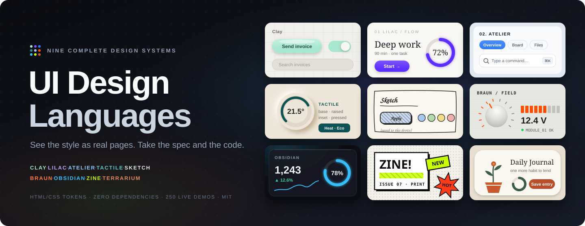
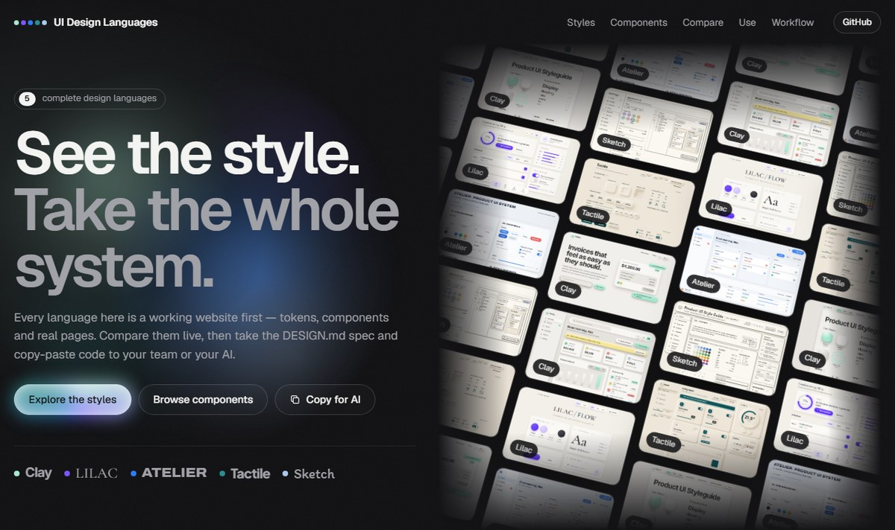
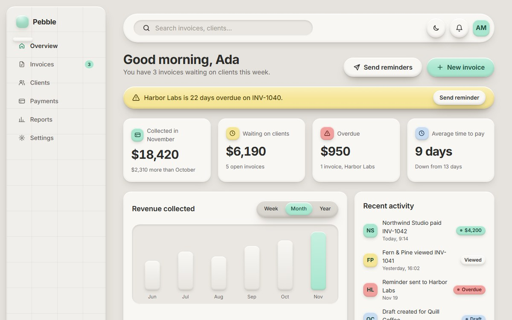
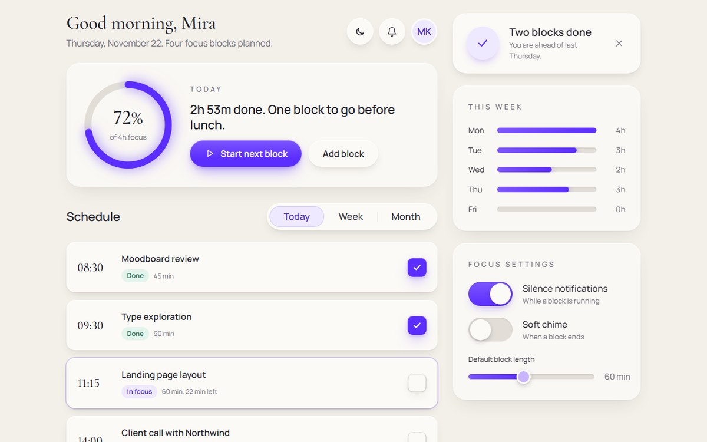
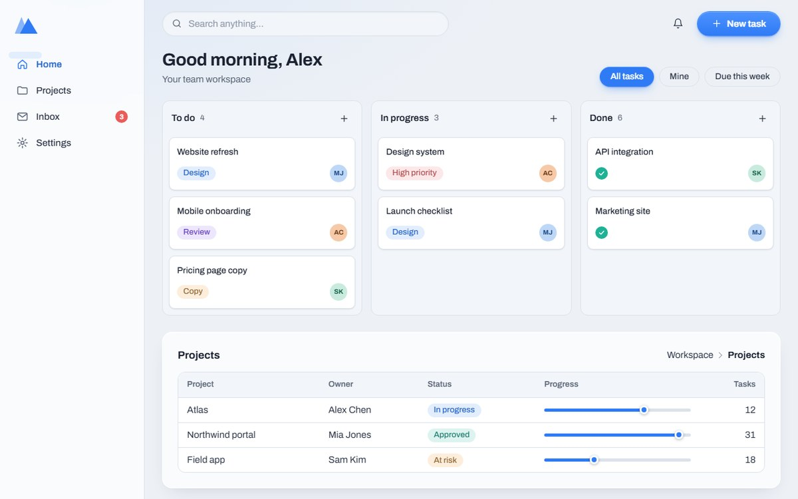
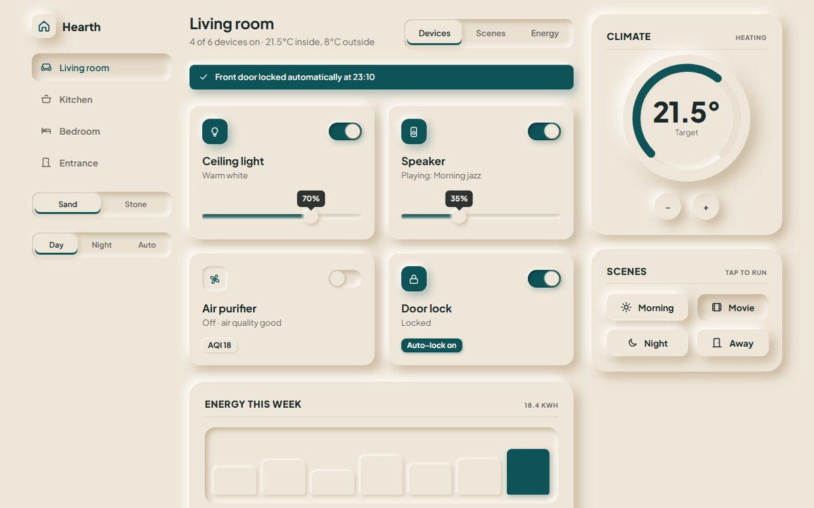
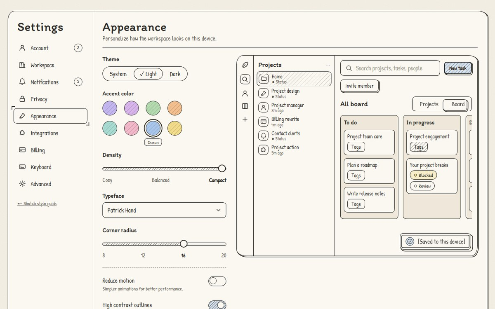
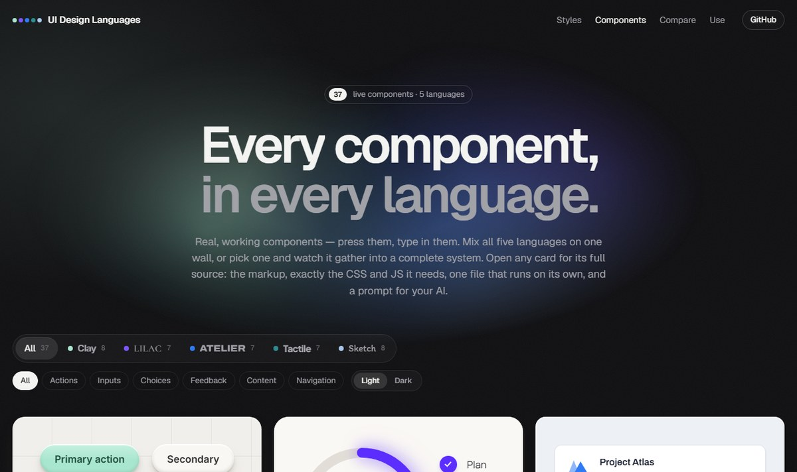

<p align="center">
  <a href="https://seiya058904.github.io/ui-design-languages/">
    
  </a>
</p>

<h1 align="center">🎨 UI Design Languages</h1>

<p align="center">
  <strong>See the style as real pages. Take the whole system.</strong>
</p>

<p align="center">
  A library of complete, self-contained UI design languages (“Style Packs”).<br>
  Compare every aesthetic as live working websites — then take the <code>DESIGN.md</code> spec and copy-paste code for your team or your AI.
</p>

<p align="center">
  <a href="https://seiya058904.github.io/ui-design-languages/"></a>
  
  
  
  <a href="LICENSE"></a>
</p>

<p align="center">
  <a href="https://seiya058904.github.io/ui-design-languages/"><strong>▶ Open Live Library</strong></a>
  &nbsp;·&nbsp;
  <a href="https://seiya058904.github.io/ui-design-languages/components.html">🧩 Component Wall</a>
  &nbsp;·&nbsp;
  <a href="#style-packs">🎨 Five Style Packs</a>
  &nbsp;·&nbsp;
  <a href="#what-each-pack-ships">✨ What's Inside</a>
  &nbsp;·&nbsp;
  <a href="#use-a-pack">⚡ Use a Pack</a>
  &nbsp;·&nbsp;
  <a href="#develop">🛠️ Develop</a>
</p>

<p align="center">
  <sub>PLAIN HTML / CSS TOKENS &nbsp;·&nbsp; OPTIONAL VANILLA JS &nbsp;·&nbsp; LIGHT &amp; DARK THEMES &nbsp;·&nbsp; NO BUILD STEP &nbsp;·&nbsp; AI-READY SPECS</sub>
</p>

<p align="center">
  <a href="https://seiya058904.github.io/ui-design-languages/">
    
  </a>
  <br>
  <sub>REAL BROWSER CAPTURE · EVERY PACK IS A WORKING SITE WITH TOKENS, COMPONENTS, EXAMPLES AND DESIGN.MD</sub>
</p>

---

> **Screenshots lie. Working pages don't.**
>
> Instead of static moodboards or Figma-only kits, every language in this library is built first as real HTML, CSS custom properties, and interactive states. Click the controls, switch light and dark mode, inspect the exact tokens, and hand the `DESIGN.md` + `AGENTS.md` directly to a developer or coding agent.

<a id="style-packs"></a>
## 🎨 Five Complete Style Packs

Each top-level folder is completely self-contained. Copy one folder into your project — or link it via CDN — and it works on its own.

<table>
  <tr>
    <td width="50%" valign="top">
      <a href="https://seiya058904.github.io/ui-design-languages/clay/examples/dashboard.html">
        
      </a>
      <h3>🟢 Clay</h3>
      <p><sub>EXTRUDED CLAY · MATTE GRID BOARD · MINT ACCENT · LIGHT + DARK</sub></p>
      <p>Soft, puffed physical surfaces resting on a quiet architectural grid board, paired with tactile pill buttons and a fresh mint highlight.</p>
      <p>
        <a href="clay/DESIGN.md"><strong>DESIGN.md</strong></a> ·
        <a href="https://seiya058904.github.io/ui-design-languages/clay/">Styleguide</a> ·
        <a href="https://seiya058904.github.io/ui-design-languages/clay/examples/dashboard.html">Dashboard</a> ·
        <a href="https://seiya058904.github.io/ui-design-languages/clay/examples/landing.html">Landing</a>
      </p>
    </td>
    <td width="50%" valign="top">
      <a href="https://seiya058904.github.io/ui-design-languages/lilac/examples/app.html">
        
      </a>
      <h3>🟣 Lilac</h3>
      <p><sub>IVORY TILES · GLOWING VIOLET · EDITORIAL SERIF · LIGHT + DARK</sub></p>
      <p>Calm ivory study surfaces and literary serif headings punctuated by a single radiant violet accent (with an optional cobalt variant).</p>
      <p>
        <a href="lilac/DESIGN.md"><strong>DESIGN.md</strong></a> ·
        <a href="https://seiya058904.github.io/ui-design-languages/lilac/">Styleguide</a> ·
        <a href="https://seiya058904.github.io/ui-design-languages/lilac/examples/app.html">Focus Planner</a>
      </p>
    </td>
  </tr>
  <tr>
    <td width="50%" valign="top">
      <a href="https://seiya058904.github.io/ui-design-languages/atelier/examples/workspace.html">
        
      </a>
      <h3>🔵 Atelier</h3>
      <p><sub>FROSTED PRODUCT UI · COBALT ACCENT · APPEARANCE SETTINGS</sub></p>
      <p>Precise, cool-toned software craft: crisp hairline borders, frosted panels, bold uppercase metadata, and working live appearance controls.</p>
      <p>
        <a href="atelier/DESIGN.md"><strong>DESIGN.md</strong></a> ·
        <a href="https://seiya058904.github.io/ui-design-languages/atelier/">Styleguide</a> ·
        <a href="https://seiya058904.github.io/ui-design-languages/atelier/examples/workspace.html">Workspace</a>
      </p>
    </td>
    <td width="50%" valign="top">
      <a href="https://seiya058904.github.io/ui-design-languages/tactile/examples/home.html">
        
      </a>
      <h3>🟤 Tactile</h3>
      <p><sub>WARM SAND NEUMORPHISM · 4 MATERIAL LAYERS · DEEP TEAL</sub></p>
      <p>Sculpted light and shadow across four distinct surface states — base, raised, inset, and pressed — anchored by a deep mineral teal.</p>
      <p>
        <a href="tactile/DESIGN.md"><strong>DESIGN.md</strong></a> ·
        <a href="https://seiya058904.github.io/ui-design-languages/tactile/">Styleguide</a> ·
        <a href="https://seiya058904.github.io/ui-design-languages/tactile/examples/home.html">Smart Home</a>
      </p>
    </td>
  </tr>
  <tr>
    <td width="50%" valign="top">
      <a href="https://seiya058904.github.io/ui-design-languages/sketch/examples/settings.html">
        
      </a>
      <h3>✏️ Sketch</h3>
      <p><sub>HAND-DRAWN INK · CREAM PAPER · HATCHING · WATERCOLOR TINTS</sub></p>
      <p>Honest notebook wireframes brought to life: crisp ink strokes, diagonal hatched sliders and fills, and gentle watercolor accent swatches.</p>
      <p>
        <a href="sketch/DESIGN.md"><strong>DESIGN.md</strong></a> ·
        <a href="https://seiya058904.github.io/ui-design-languages/sketch/">Styleguide</a> ·
        <a href="https://seiya058904.github.io/ui-design-languages/sketch/examples/settings.html">Settings</a>
      </p>
    </td>
    <td width="50%" valign="top">
      <a href="https://seiya058904.github.io/ui-design-languages/components.html">
        
      </a>
      <h3>🧩 The Component Wall</h3>
      <p><sub>37 LIVE COMPONENTS · SINGLE-FILE EXPORT · AI PROMPT GENERATOR</sub></p>
      <p>Browse every component across all five languages on one wall, filter to gather a single system onto its native canvas, and open any card for its exact minimal HTML, CSS, JS, runnable file, and AI prompt.</p>
      <p>
        <a href="https://seiya058904.github.io/ui-design-languages/components.html"><strong>Open Component Wall →</strong></a>
      </p>
    </td>
  </tr>
</table>

### Quick Index

| Pack | Folder | Character | Design Spec | Agent Rules | Live Styleguide |
| :--- | :--- | :--- | :--- | :--- | :--- |
| **Clay** | [`clay/`](clay/) | Soft extruded clay on matte grid board, mint accent, light + dark | [DESIGN.md](clay/DESIGN.md) | [AGENTS.md](clay/AGENTS.md) | [Open →](https://seiya058904.github.io/ui-design-languages/clay/) |
| **Lilac** | [`lilac/`](lilac/) | Ivory study tiles, glowing violet accent, editorial serif, light + dark | [DESIGN.md](lilac/DESIGN.md) | [AGENTS.md](lilac/AGENTS.md) | [Open →](https://seiya058904.github.io/ui-design-languages/lilac/) |
| **Atelier** | [`atelier/`](atelier/) | Precise frosted product UI, cobalt accent, live appearance controls | [DESIGN.md](atelier/DESIGN.md) | [AGENTS.md](atelier/AGENTS.md) | [Open →](https://seiya058904.github.io/ui-design-languages/atelier/) |
| **Tactile** | [`tactile/`](tactile/) | Warm sand neumorphism, 4 material layers, deep teal, light + dark | [DESIGN.md](tactile/DESIGN.md) | [AGENTS.md](tactile/AGENTS.md) | [Open →](https://seiya058904.github.io/ui-design-languages/tactile/) |
| **Sketch** | [`sketch/`](sketch/) | Hand-drawn ink on cream paper, hatched fills, watercolor tints | [DESIGN.md](sketch/DESIGN.md) | [AGENTS.md](sketch/AGENTS.md) | [Open →](https://seiya058904.github.io/ui-design-languages/sketch/) |

<a id="what-each-pack-ships"></a>
## ✨ What Every Pack Ships

<table>
  <tr>
    <td width="50%" valign="top">
      <h3>🎛️ Single-Source Design Tokens</h3>
      <p>Every pack's <code>tokens/tokens.json</code> (plus dark and variant overrides) compiles deterministically into CSS custom properties (<code>var(--&lt;pack&gt;-*)</code>). Zero magic values scattered in component rules.</p>
    </td>
    <td width="50%" valign="top">
      <h3>🧩 Shared Component Anatomy</h3>
      <p>All five languages share the same component vocabulary (<code>btn</code>, <code>field</code>, <code>chip</code>, <code>badge</code>, <code>segmented</code>, <code>tabs</code>, <code>alert</code>, <code>card</code>, <code>nav</code>, <code>toggle</code>, <code>table</code>, <code>dialog</code>, <code>tooltip</code>) and ARIA state hooks, so markup ports cleanly by swapping prefixes.</p>
    </td>
  </tr>
  <tr>
    <td width="50%" valign="top">
      <h3>📋 Complete Minimal Source</h3>
      <p>Every component demo in the styleguides and Component Wall includes a <code>&lt;/&gt;</code> inspector that extracts the exact markup, only the CSS rules and tokens that component needs (light and dark), its optional script, and a standalone runnable HTML download.</p>
    </td>
    <td width="50%" valign="top">
      <h3>🤖 Built for Humans &amp; Coding Agents</h3>
      <p>Hand an AI coding assistant a pack's <code>DESIGN.md</code> (aesthetic intent, foundations, visual rules) and <code>AGENTS.md</code> (non-negotiable token and recipe rules) — or copy a ready-made prompt straight from the Component Wall.</p>
    </td>
  </tr>
</table>

<a id="use-a-pack"></a>
## ⚡ Use a Pack

### Option 1 · Link directly via CDN

```html
<!-- 1. Load the fonts listed in the pack's README, then its entry CSS -->
<link rel="stylesheet" href="https://cdn.jsdelivr.net/gh/seiya058904/ui-design-languages@main/atelier/css/atelier.css">

<!-- 2. Compose with the pack's prefixed classes -->
<button class="atelier-btn atelier-btn--primary">Create task</button>

<!-- 3. Optional behaviour (sliding indicators, theme / appearance, dialogs) -->
<script src="https://cdn.jsdelivr.net/gh/seiya058904/ui-design-languages@main/atelier/js/atelier.js"></script>
```

### Option 2 · Copy a self-contained folder

Copy any pack directory (`clay/`, `lilac/`, `atelier/`, `tactile/`, or `sketch/`) directly into your project. Every pack has zero npm dependencies, zero build steps, and prefixed classes/tokens so it won't collide with your app styles.

### Option 3 · Hand off to an AI assistant

Point your coding agent at `<pack>/DESIGN.md` and `<pack>/AGENTS.md` (plus `packs.json` for machine-readable entry paths, font URLs, and variant metadata).

<a id="develop"></a>
## 🛠️ Develop & Verify

Requires **Node 18+** and a local Chrome or Edge (`CHROME_PATH` to override). **No npm dependencies.**

```bash
node scripts/new-pack.mjs <id> [Name]   # scaffold a new design language (see docs/WORKFLOW.md)
node scripts/build-tokens.mjs [pack]    # rebuild tokens.css after editing tokens/*.json
node scripts/check.mjs [pack]           # full pre-commit gate: tokens, 1280/390 screenshots, component source parity
```

<details>
<summary><strong>📁 Repository layout &amp; verification scripts</strong></summary>

```text
index.html                 Library homepage (live previews & comparison)
components.html            Component Wall: all 5 languages, 37 live components + source drawer
packs.json                 Machine-readable registry of packs, tokens, fonts, variants & wall picks
site/                      Website chrome only (wall.js, source.js, smooth-scroll.js — never part of a pack)
<pack>/
  tokens/                  tokens.json (+ dark & variant JSONs) → generated tokens.css
  css/                     Entry stylesheet, base layer & component rules
  js/                      Optional vanilla JS behaviours
  index.html               Interactive styleguide
  components.html          Full component catalog (real working markup)
  examples/                Real application & landing pages
  DESIGN.md                Design intent, foundations & visual specification
  AGENTS.md                Non-negotiable coding rules & recipes for AI agents
  README.md                Pack-specific overview & font links
scripts/
  new-pack.mjs             Scaffold a new language that already passes checks
  build-tokens.mjs         Compile tokens/*.json → tokens.css (--check to verify sync)
  snap.mjs                 Real-browser captures into .snapshots/ (fails on horizontal overflow)
  check-source.mjs         Verifies every demo's single-file export renders identically (light + dark)
  check.mjs                Runs build-tokens --check, snap, and check-source together
docs/
  WORKFLOW.md              Reference image → scaffold → spec → tokens → components → check
```

</details>

## 📄 Licenses

Code and documentation: **[MIT](LICENSE)**. Fonts are loaded from Google Fonts under the **SIL Open Font License** (`Inter`, `Cormorant Garamond`, `Manrope`, `Archivo`, `Plus Jakarta Sans`, `Itim`, `Patrick Hand`). Icons are drawn for this repository. Reference images that inspired the packs are not redistributed.

---

<p align="center">
  <sub>SEE THE STYLE. INSPECT THE TOKENS. TAKE THE WHOLE SYSTEM.</sub><br>
  <sub>UI Design Languages · Plain HTML/CSS design systems with zero dependencies.</sub>
</p>
