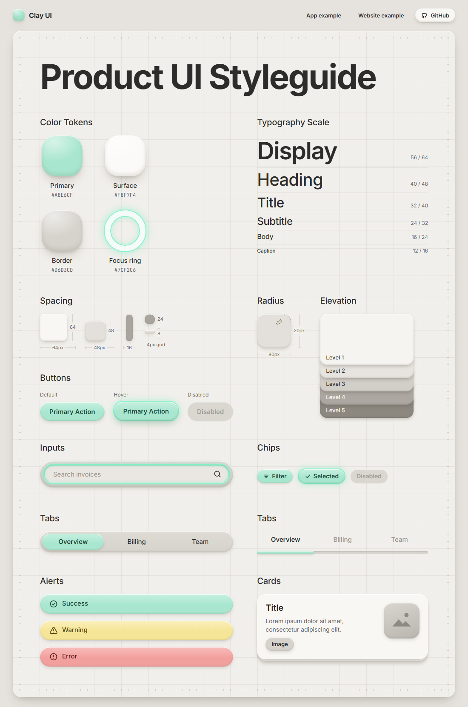
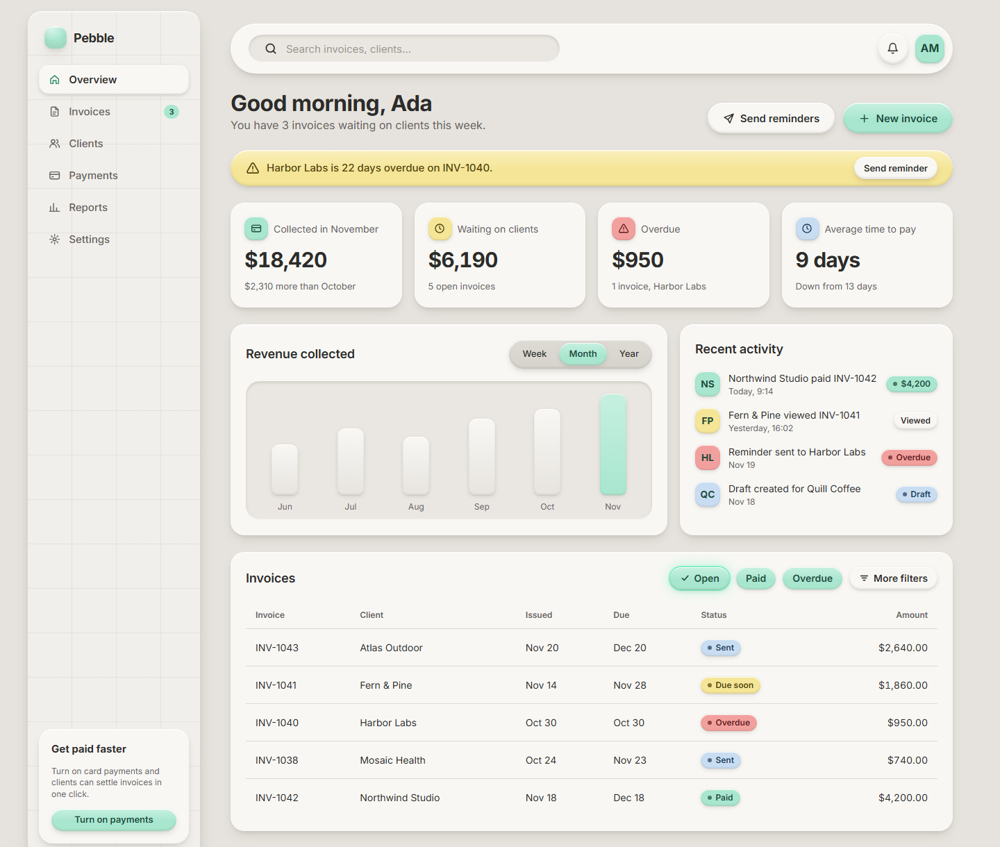
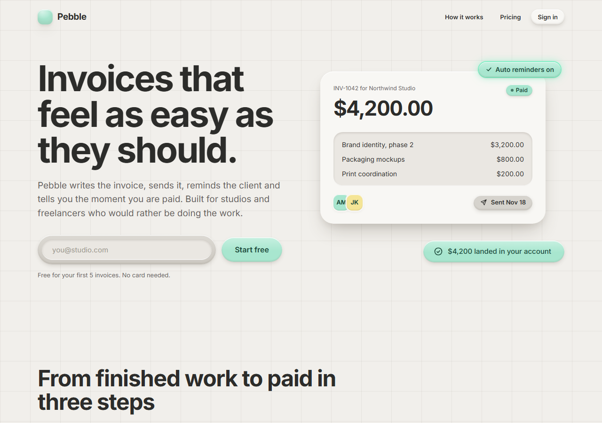

# Clay UI

A soft, extruded clay design language for websites and apps — matte paper boards, mint clay accents, carved inputs and a glowing focus ring. Plain CSS, design tokens and copy-paste HTML. No build step, no dependencies.

**Live styleguide:** https://seiya058904.github.io/clay-ui/ · [App example](https://seiya058904.github.io/clay-ui/examples/dashboard.html) · [Website example](https://seiya058904.github.io/clay-ui/examples/landing.html)



## Quick start

```html
<link rel="preconnect" href="https://fonts.googleapis.com">
<link href="https://fonts.googleapis.com/css2?family=Inter:wght@400;500;600;700&display=swap" rel="stylesheet">
<link rel="stylesheet" href="https://cdn.jsdelivr.net/gh/seiya058904/clay-ui@main/css/clay.css">

<main class="clay-board" style="padding:48px">
  <label class="clay-field">
    <span class="clay-field__control"><input type="search" placeholder="Search invoices" aria-label="Search invoices"></span>
  </label>
  <button class="clay-btn clay-btn--primary">Send invoice</button>
</main>

<!-- optional: tabs, toggle chips, dialogs -->
<script src="https://cdn.jsdelivr.net/gh/seiya058904/clay-ui@main/js/clay.js"></script>
```

Or clone the repo and link `css/clay.css` locally. Open `index.html` in a browser to see every component.

## What's inside

| Path | Contents |
| --- | --- |
| `tokens/tokens.json` | Design tokens (W3C format) — the single source of truth |
| `tokens/tokens.css` | CSS custom properties generated from the JSON |
| `css/clay.css` | Entry point: tokens + base + all components |
| `css/base.css` | Reset, typography, board, grid, ruler, layout helpers |
| `css/components/` | Button, input, chip & badge, tabs, alert, card, surfaces (swatch, elevation, avatar, progress), controls (toggle, checkbox, radio), navigation (nav, top bar, table, dialog, tooltip) |
| `js/clay.js` | Optional behaviour for tabs, chips and dialogs |
| `assets/icons.html` | Inline SVG icon sprite |
| `index.html` | Styleguide sheet (recreates the reference) + extended components |
| `examples/` | `dashboard.html` (invoicing app) and `landing.html` (marketing site) |
| `docs/` | Principles, token reference, component reference, AI prompts |
| `AGENTS.md` | Rules for AI agents rebuilding this look |

## The language in one minute

- **Raised** pieces are pressable, **carved** pieces are fillable, **flat** pieces are disabled.
- **Mint** is the only accent: primary action, selection, success.
- **Pills** for controls, 20px cards, 34% squircles for swatches and avatars.
- **Warm shadows** with a bright top edge; never black.
- **Glow ring** for focus and the selected state.
- **Inter**, bold and tight for headlines, sentence case everywhere.

Read [docs/principles.md](docs/principles.md) for the full rationale.

## Using it with AI

Point your assistant at [AGENTS.md](AGENTS.md), or paste a prompt from [docs/ai-prompt.md](docs/ai-prompt.md). Prompt B works without the repository and in any stack (React, SwiftUI, Flutter, Compose…).

## Editing tokens

```bash
# edit tokens/tokens.json, then
node scripts/build-tokens.mjs          # regenerate tokens/tokens.css
node scripts/build-tokens.mjs --check  # verify they are in sync
```

## Examples

| App | Website |
| --- | --- |
|  |  |

## Browser support

Current Chrome, Edge, Firefox and Safari. Uses CSS custom properties, `:focus-visible`, `<dialog>` and `appearance: none`.

## License

[MIT](LICENSE).
