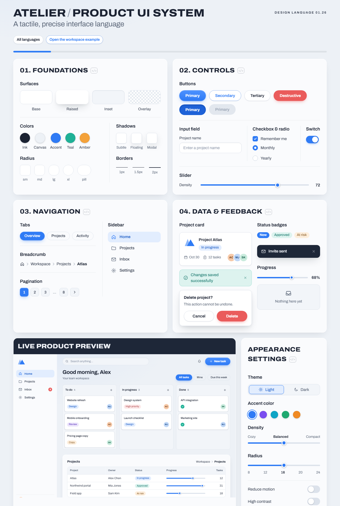
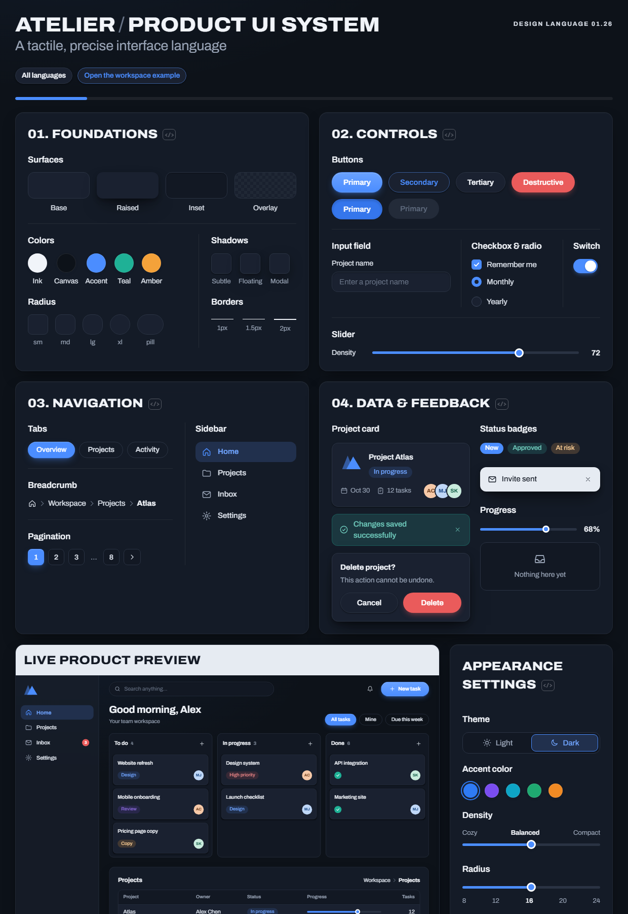
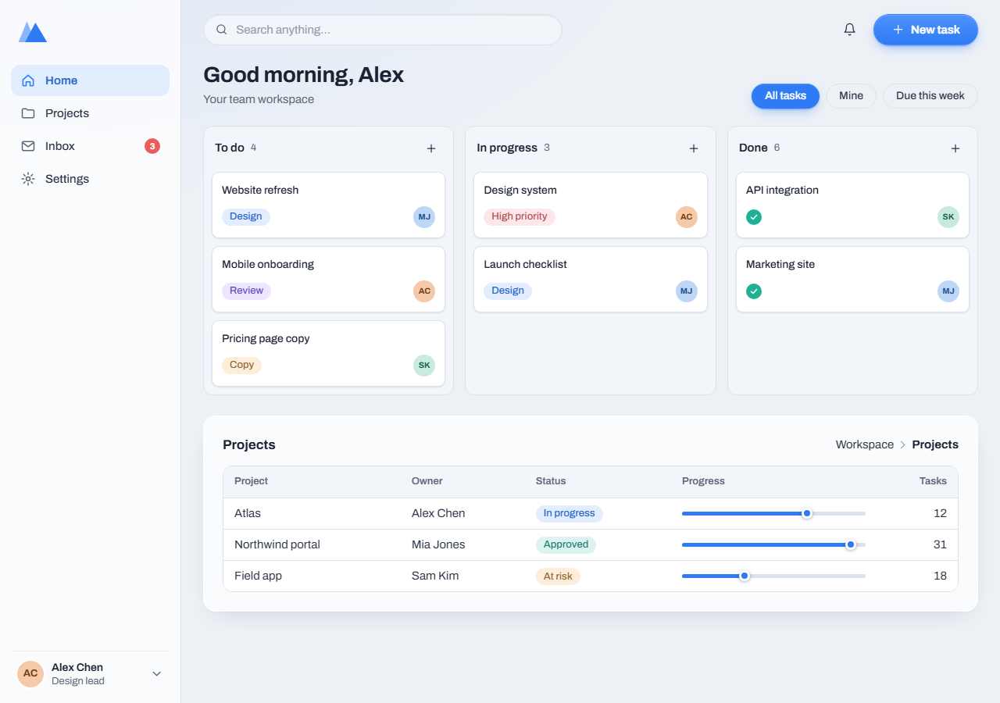

# Atelier

A tactile, precise product-UI language: frosted panels on a cool canvas, one accent, bold semi-expanded section titles — and an appearance panel that really works (theme, accent, density, radius, motion, contrast). Plain CSS, design tokens and copy-paste HTML; no build step, no dependencies.

**Live:** [Styleguide](https://seiya058904.github.io/ui-design-languages/atelier/) · [Workspace example](https://seiya058904.github.io/ui-design-languages/atelier/examples/workspace.html)

| Light, cobalt, balanced | Dark, violet, compact, radius 24 |
| --- | --- |
|  |  |

## Quick start

```html
<head>
  <!-- restore saved appearance before first paint -->
  <script>try{var s=JSON.parse(localStorage.getItem("atelier-appearance")||"{}"),d=document.documentElement;s.theme&&s.theme!=="light"&&d.setAttribute("data-theme",s.theme);s.accent&&s.accent!=="cobalt"&&d.setAttribute("data-accent",s.accent);s.density&&s.density!=="balanced"&&d.setAttribute("data-density",s.density);s.radius&&s.radius!=16&&d.style.setProperty("--atelier-radius-base",s.radius+"px");s.motion==="reduced"&&d.setAttribute("data-motion","reduced");s.contrast==="high"&&d.setAttribute("data-contrast","high")}catch(e){}</script>
  <link href="https://fonts.googleapis.com/css2?family=Archivo:wdth,wght@100..125,400..800&display=swap" rel="stylesheet">
  <link rel="stylesheet" href="https://cdn.jsdelivr.net/gh/seiya058904/ui-design-languages@main/atelier/css/atelier.css">
</head>
<body>
  <section class="atelier-panel">
    <h2 class="atelier-section-title">01. Controls</h2>
    <button class="atelier-btn atelier-btn--primary">Primary</button>
    <button class="atelier-btn atelier-btn--secondary">Secondary</button>
  </section>
  <script src="https://cdn.jsdelivr.net/gh/seiya058904/ui-design-languages@main/atelier/js/atelier.js"></script>
</body>
```

Appearance controls are plain markup — `data-appearance="theme|accent|density|radius|motion|contrast"` on buttons, range inputs or checkboxes (see `index.html`). Settings persist in `localStorage` and sync live to other open pages and iframes. Or set them in code: `AtelierUI.setAppearance({ theme: "dark", accent: "green" })`.

## Components

| Block | Classes |
| --- | --- |
| Type | `.atelier-display` (+ `__slash`), `.atelier-tagline`, `.atelier-section-title`, `.atelier-kicker`, `.atelier-title`, `-heading`, `-label`, `-caption` |
| Layout | `.atelier-panel` (frosted), `.atelier-group-label`, `.atelier-rule`, `.atelier-divider`, `.atelier-stack`, `.atelier-row` |
| Button | `.atelier-btn` + `--primary` `--secondary` `--tertiary` `--destructive` `--ghost` · `--sm` `--lg` `--icon` `--block` · `.is-active` = pressed |
| Inputs | `.atelier-input` (input / select / textarea), `.atelier-search`, `.atelier-form-row`, `.atelier-field-label`, `.atelier-hint` |
| Selection | `.atelier-check` (`--between`) with `.atelier-checkbox`, `.atelier-radio`, `.atelier-toggle` |
| Slider | `.atelier-slider`, `.atelier-slider-row`, `.atelier-slider-stops` |
| Navigation | `.atelier-pills` (filled sliding pill), `.atelier-segmented` (soft sliding pill), `.atelier-breadcrumb`, `.atelier-pagination`, `.atelier-nav` (+ `__count`) |
| Data | `.atelier-card` (`--interactive`, `__title`, `__meta`), `.atelier-badge` (`--primary` `--soft` `--teal` `--amber` `--danger` `--violet`), `.atelier-avatar(s)`, `.atelier-progress`, `.atelier-table` |
| Board | `.atelier-board` (`--columns`), `.atelier-column` (+ `__head`, `__count`), `.atelier-task` (+ `__foot`), `.atelier-done` |
| Feedback | `.atelier-toast` (`--success` `--warning` `--danger` `--inverse`), `.atelier-confirm`, `.atelier-empty`, `.atelier-dialog`, `.atelier-tooltip[data-tip]` |
| Appearance | `.atelier-swatch` (`--pick` for accent pickers) |

## Tokens

`tokens/tokens.json` → `tokens/tokens.css`, plus `tokens.dark.json` and variants `tokens.accent-*.json`, `tokens.density-*.json`, `tokens.motion-reduced.json`, `tokens.contrast-high.json`. Rebuild from the repo root with `node scripts/build-tokens.mjs atelier`.

| Role | Token | Light |
| --- | --- | --- |
| Canvas / panel / surface | `--atelier-color-canvas` / `-panel` / `-surface` | `#EDF1F6` / white 72% / `#FFFFFF` |
| Ink / text / muted | `--atelier-color-ink` / `-text` / `-text-muted` | `#1B2232` / `#283143` / `#5B6678` |
| Accent | `--atelier-color-primary` | `#2F7BF5` |
| Status | `--atelier-color-teal` / `-amber` / `-danger` / `-violet` | `#1FB196` / `#F4A23A` / `#EA5B5B` / `#7C4DE8` |
| Radius | `--atelier-radius-base` → `sm/md/lg/xl` | 16 → 8 / 12 / 16 / 24 |
| Controls | `--atelier-size-control-sm/-/lg`, `--atelier-size-row` | 32 / 40 / 48, 40 |

## Example



`examples/workspace.html` — sidebar, search, kanban board and a projects table. The styleguide embeds it as a live preview that follows the appearance panel.

For AI agents: read [AGENTS.md](AGENTS.md) first.
