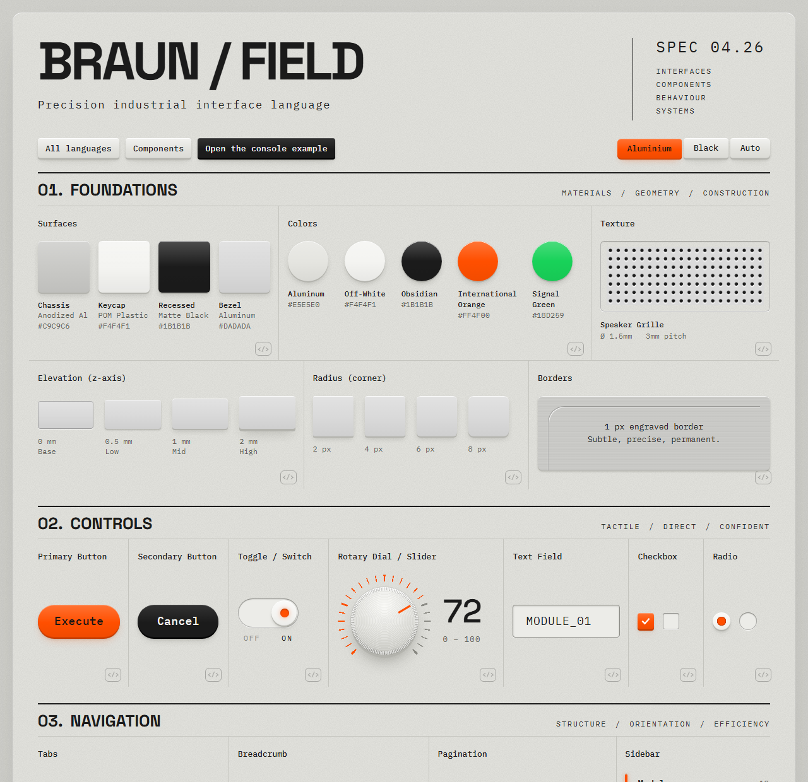
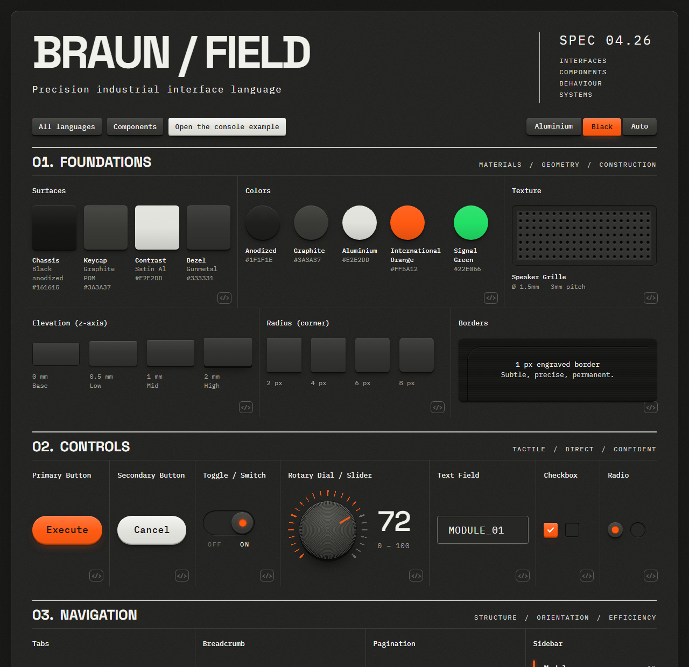
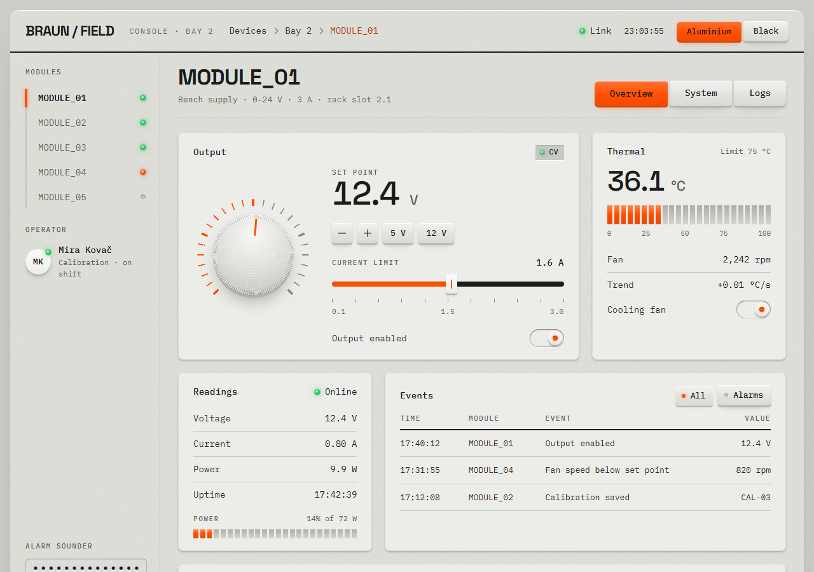

# Braun / Field

A precision industrial interface language: anodized aluminium, POM keycaps with real travel, matte-black recesses, one International Orange and a signal-green lamp — with a rotary dial you can actually turn and LED meters that light up segment by segment. Plain CSS, design tokens and copy-paste HTML; no build step, no dependencies.

**Live:** [Styleguide](https://seiya058904.github.io/ui-design-languages/braun/) · [Console example](https://seiya058904.github.io/ui-design-languages/braun/examples/console.html) · [Components](https://seiya058904.github.io/ui-design-languages/braun/components.html)

| Aluminium | Black edition |
| --- | --- |
|  |  |

## Quick start

```html
<link href="https://fonts.googleapis.com/css2?family=Space+Grotesk:wght@500;700&family=IBM+Plex+Mono:wght@400;500;600&display=swap" rel="stylesheet">
<link rel="stylesheet" href="https://cdn.jsdelivr.net/gh/seiya058904/ui-design-languages@main/braun/css/braun.css">

<header class="braun-section"><h2><span>02.</span>Controls</h2><p>Tactile / Direct / Confident</p></header>
<button class="braun-btn braun-btn--primary braun-btn--pill">Execute</button>
<div class="braun-dial" style="--braun-value:72">
  <div class="braun-dial__knob" role="slider" tabindex="0" aria-label="Output" aria-valuemin="0" aria-valuemax="100" aria-valuenow="72"></div>
</div>

<script src="https://cdn.jsdelivr.net/gh/seiya058904/ui-design-languages@main/braun/js/braun.js"></script>
```

Black edition: `<html data-theme="dark">` (or `"auto"`), or `[data-theme-set="light|dark|auto"]` / `[data-theme-toggle]` controls with `js/braun.js` (remembered as `braun-theme`).

## Components

| Block | Classes |
| --- | --- |
| Structure | `.braun-panel`, `.braun-section` (numbered title + spec triplet), `.braun-display`, `.braun-tagline`, `.braun-label`, `.braun-spec`, `.braun-numeral`, `.braun-boot` (power-on entrance) |
| Keys | `.braun-btn` + `--primary` `--inverse` `--ghost` · `--pill` · `--sm` `--lg` `--icon` `--block` · `aria-pressed="true"` (latched) · `:disabled` (locked flush) |
| Selection | `.braun-keys` (interlocking, `__item[aria-selected]`, `--sm` `--block`), `.braun-tabs` (needle), `.braun-chip[aria-pressed]` (lamp) |
| Inputs | `.braun-field` (`__label`), `.braun-input` (`--lg`, `aria-invalid`), `.braun-hint` (`--error`), `.braun-affix` |
| Switches | `.braun-switch` (`--sm` `--lg`) inside `.braun-toggle` + `__legend`, `.braun-checkbox`, `.braun-radio`, `.braun-check` |
| Instruments | `.braun-dial` + `__knob`, `.braun-readout` (`__value`, `__range`), `.braun-fader` + `.braun-scale`, `.braun-meter` (`--sm`, `--live` + `__peak`, fed by a `[data-braun-signal]` key), `.braun-gauge`, `.braun-progress`, `.braun-led` (`--warn` `--off` `--blink`), `.braun-scope` (`__screen`, `__trace` with `__ghost` / `__line`, `__tag`, `__readings`, `__controls`; `[data-braun-scope="run"]`, `[data-braun-wave]`) |
| Navigation | `.braun-nav` (`__item[aria-current]`, `__count`), `.braun-breadcrumb`, `.braun-pagination` (`__gap`) |
| Data | `.braun-card` (`__head`, `__title`, `__text`, `__actions`, `--inset`), `.braun-readings`, `.braun-glyph`, `.braun-badge` (`--primary` `--inverse` `--outline`), `.braun-status`, `.braun-table` (`.is-num`), `.braun-avatar` (`--lg` `--square` `--inverse`), `.braun-person` |
| Feedback | `.braun-toast` (`__time`), `.braun-alert` (`__icon` `__title` `__text` `__close`, `--neutral`), `.braun-dialog` (`__body` `__title` `__text` `__actions`), `.braun-tooltip[data-tip]`, `.braun-tip` |
| Materials | `.braun-grille`, `.braun-engraved`, `.braun-swatch`, `.braun-specimen`, `.braun-level-0…3` |

## Tokens

`tokens/tokens.json` → `tokens/tokens.css`; black edition `tokens/tokens.dark.json`. Rebuild from the repo root with `node scripts/build-tokens.mjs braun`.

| Role | Token | Aluminium | Black |
| --- | --- | --- | --- |
| Panel | `--braun-color-canvas` | `#E5E5E0` | `#1F1F1E` |
| Accent | `--braun-color-primary` | `#FF4F00` | `#FF5A12` |
| Lamp | `--braun-color-signal` | `#18D259` | `#22E066` |
| Contrasting key | `--braun-color-inverse` | `#1B1B1B` | `#E2E2DD` |
| Radius | `--braun-radius-xs…xl` | 2 / 4 / 6 / 8 / 14 | |
| Motion | `--braun-motion-duration-press` / `-release` | 55 / 140 ms | |

## Example



`examples/console.html` — a bench power-supply console: turn the output dial and watch current, power and temperature respond; switch the fan off to push a module past its 75 °C limit and raise the alarm; calibrate, reset, filter the event log.

For AI agents: read [AGENTS.md](AGENTS.md) first.

*Braun / Field is an homage to the functionalist industrial-design tradition; it is not affiliated with or endorsed by Braun GmbH.*
