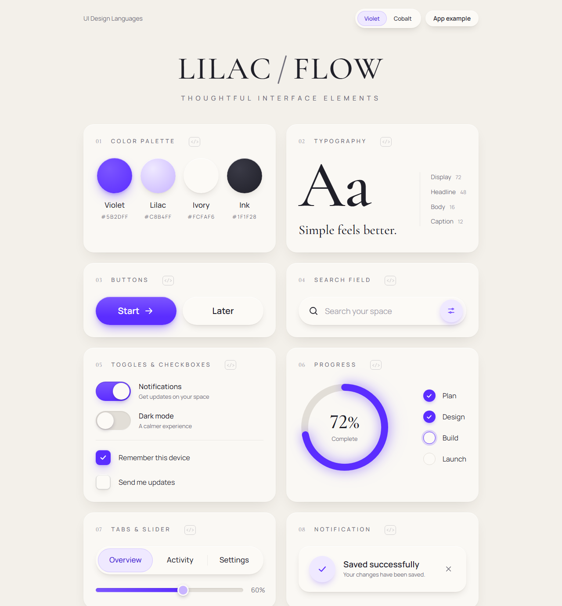
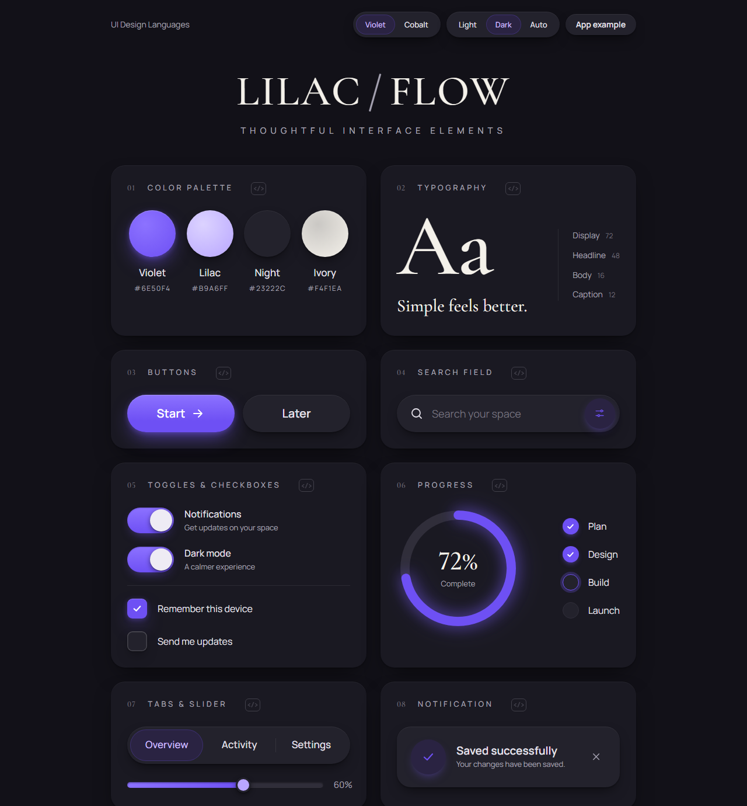
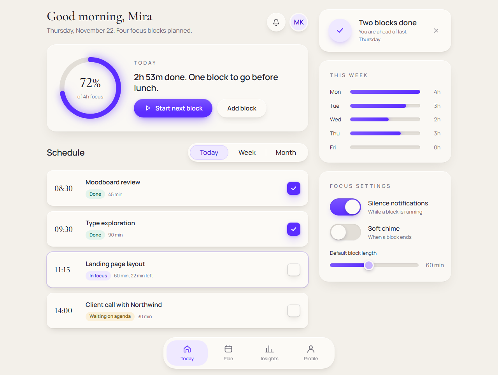

# Lilac

An ivory component-study design language: calm tiles, one accent that glows, editorial serif headlines. Violet by default, cobalt on request, light or dark. Plain CSS, design tokens and copy-paste HTML — no build step, no dependencies.

**Live:** [Styleguide](https://seiya058904.github.io/ui-design-languages/lilac/) · [App example](https://seiya058904.github.io/ui-design-languages/lilac/examples/app.html) · [Components](https://seiya058904.github.io/ui-design-languages/lilac/components.html)

| Light | Dark |
| --- | --- |
|  |  |

## Quick start

```html
<link rel="preconnect" href="https://fonts.googleapis.com">
<link href="https://fonts.googleapis.com/css2?family=Cormorant+Garamond:wght@400;500;600&family=Manrope:wght@400;500;600;700&display=swap" rel="stylesheet">
<link rel="stylesheet" href="https://cdn.jsdelivr.net/gh/seiya058904/ui-design-languages@main/lilac/css/lilac.css">

<section class="lilac-tile">
  <h2 class="lilac-eyebrow"><span class="lilac-eyebrow__num">01</span>Buttons</h2>
  <button class="lilac-btn lilac-btn--primary">Start</button>
  <button class="lilac-btn">Later</button>
</section>

<script src="https://cdn.jsdelivr.net/gh/seiya058904/ui-design-languages@main/lilac/js/lilac.js"></script>
```

Cobalt accent: `<html data-accent="cobalt">`, or let users pick with `[data-accent-set="violet|cobalt"]` controls (remembered in `localStorage`).

Dark theme: `<html data-theme="dark">` (or `"auto"` to follow the OS), or `[data-theme-set="light|dark|auto"]` / `[data-theme-toggle]` controls with `js/lilac.js` (remembered as `lilac-theme`). To avoid a flash, restore it in `<head>`: `<script>try{var t=localStorage.getItem("lilac-theme");if(t&&t!=="light")document.documentElement.setAttribute("data-theme",t)}catch(e){}</script>`.

## Components

| Block | Classes |
| --- | --- |
| Type | `.lilac-wordmark` (+ `__slash`), `.lilac-eyebrow` (+ `__num`), `.lilac-display`, `-heading`, `-title`, `-subtitle`, `-lead`, `-caption`, `-numeral` |
| Tile | `.lilac-tile` — one cell of the study |
| Button | `.lilac-btn` + `--primary` `--soft` `--ghost` · `--sm` `--lg` `--icon` `--block` |
| Search field | `.lilac-field` (+ `__action` disc) · plain `.lilac-input` for input / textarea / select · `.lilac-form-row`, `.lilac-label`, `.lilac-hint` |
| Chip, badge | `.lilac-chip[aria-pressed]` · `.lilac-badge` + `--success` `--warning` `--error` `--neutral` |
| Tabs | `.lilac-segmented` (hairline dividers, sliding lilac wash) · `.lilac-tabs` (sliding underline) |
| Selection | `.lilac-check` (+ `__title`, `__hint`) with `.lilac-toggle`, `.lilac-checkbox`, `.lilac-radio` |
| Slider | `input[type=range].lilac-slider` + optional `<output for>` inside `.lilac-slider-row` |
| Progress | `.lilac-progress` (bar) · `.lilac-ring` (SVG ring, `--value`, `--ring-size`) · `.lilac-steps` (`li.is-done`, `li.is-current` breathes) |
| Focus timer | `.lilac-timer` (`data-duration` in seconds, `--value`, `--timer-size`) with `[data-lilac-timer="run|reset|add"]` controls — the ring empties, the halo breathes while it runs |
| Card stack | `.lilac-deck` > `__pile` > `__card` (`--i` depth) + `__bar` with `[data-lilac-deck="prev|next"]` and `__count` — the top card is dealt off and floats under the pile |
| Accordion | `.lilac-accordion` > `details.lilac-accordion__item` (`__head`, `__icon`, `__body`); same `name` = one open at a time |
| Feedback | `.lilac-toast` (+ `__icon`, `__title`, `__text`, `__close`) · `.lilac-alert` + `--success` `--warning` `--error` |
| Cards | `.lilac-card` (`--interactive`) · `.lilac-profile` · `.lilac-avatar` (`--xl`, `--avatar-size`, `--avatar-bg`) |
| Navigation | `.lilac-nav` sidebar · `.lilac-bottom-nav` mobile bar — both with a gliding wash |
| Data, overlays | `.lilac-table`, `.lilac-dialog`, `.lilac-tooltip[data-tip]` |
| Entrance | `.lilac-enter` (children enter one after another on page load; serif headlines inside drift in a beat later) |

Usage snippets are at the top of each block in [`css/components.css`](css/components.css); every component appears in [`index.html`](index.html).

## Tokens

`tokens/tokens.json` (single source) → `tokens/tokens.css`. Variant: `tokens/tokens.accent-cobalt.json`. Rebuild from the repo root with `node scripts/build-tokens.mjs lilac`.

| Role | Token | Value |
| --- | --- | --- |
| Canvas / tile / raised | `--lilac-color-canvas` / `-tile` / `-surface` | `#F3F0EA` / `#FAF8F4` / `#FCFAF6` |
| Accent | `--lilac-color-primary` | `#5B2DFF` (cobalt `#1556E8`) |
| Lilac | `--lilac-color-primary-soft` | `#C8B4FF` |
| Wash / on wash | `--lilac-color-primary-wash` / `--lilac-color-on-wash` | `#EFE9FF` / `#4320D6` |
| Ink / text / muted | `--lilac-color-ink` / `-text` / `-text-muted` | `#1F1F28` / `#24232D` / `#6E6C78` |
| Radii | `--lilac-radius-sm/md/lg/xl/pill` | 9 / 16 / 24 / 32 / 999 |
| Controls | `--lilac-size-control-sm/-/lg` | 36 / 48 / 60 |

## Example



`examples/app.html` — a focus planner with a progress ring, schedule cards, weekly bars, settings and a floating bottom navigation.

For AI agents: read [AGENTS.md](AGENTS.md) first.
