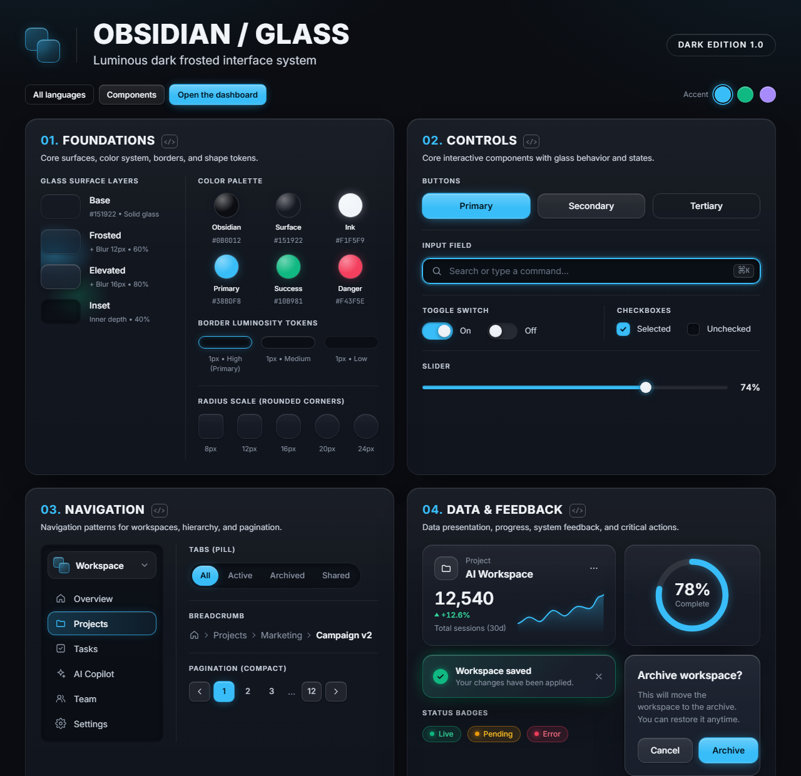
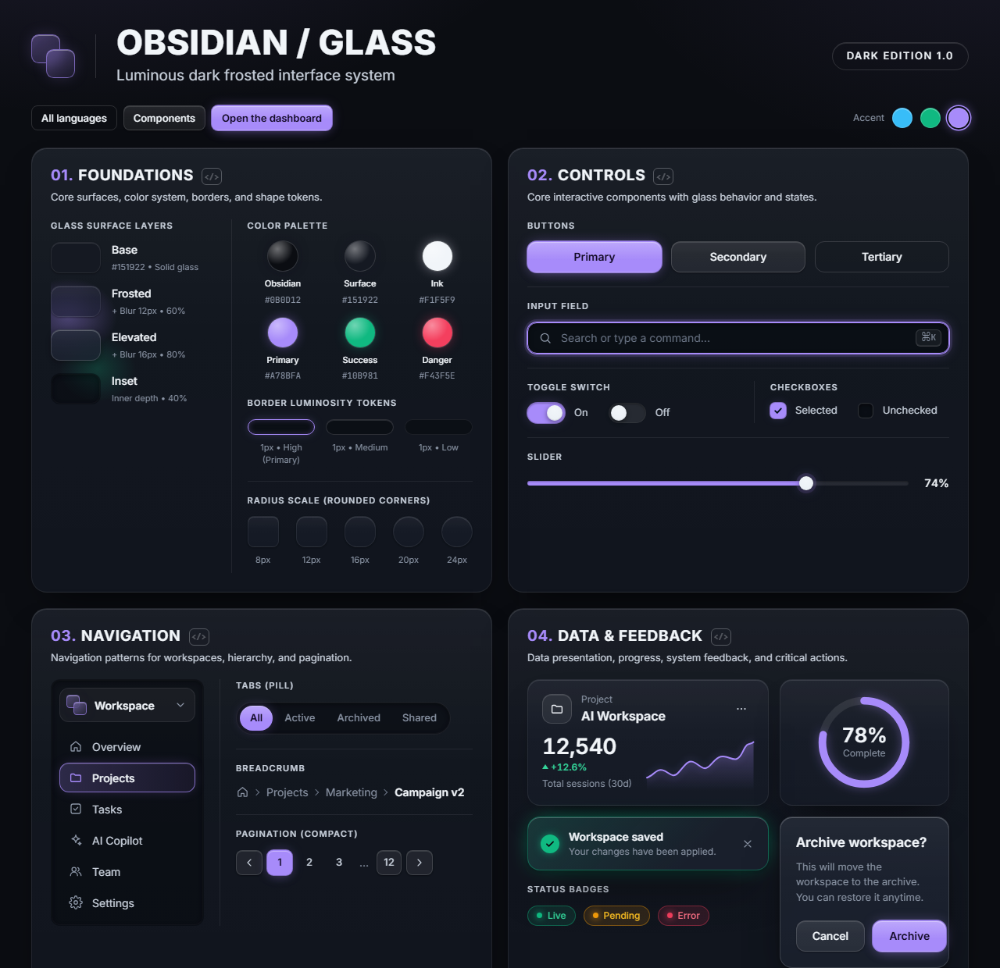
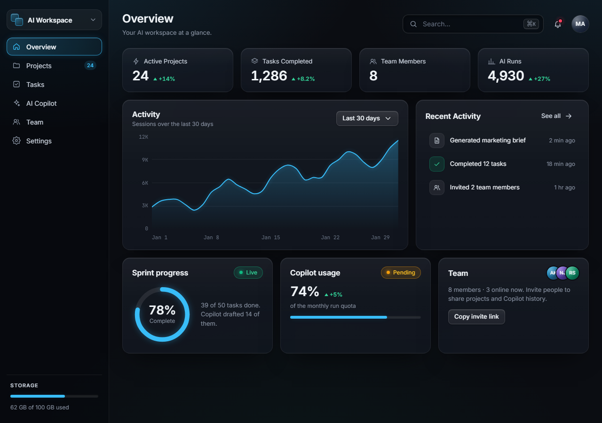

# Obsidian / Glass

A dark-first interface language: four layers of frosted glass over a deep obsidian canvas, 1px specular edges, and one luminous accent — glacier cyan, emerald or electric violet. Liquid motion, lit rims, charts that draw themselves in. Plain CSS, design tokens and copy-paste HTML; no build step, no dependencies.

**Live:** [Styleguide](https://seiya058904.github.io/ui-design-languages/obsidian/) · [AI Workspace dashboard](https://seiya058904.github.io/ui-design-languages/obsidian/examples/dashboard.html) · [Components](https://seiya058904.github.io/ui-design-languages/obsidian/components.html)

| Glacier cyan | Electric violet |
| --- | --- |
|  |  |

## Quick start

```html
<link href="https://fonts.googleapis.com/css2?family=Inter:wght@400;500;600;700;800&family=JetBrains+Mono:wght@400;500&display=swap" rel="stylesheet">
<link rel="stylesheet" href="https://cdn.jsdelivr.net/gh/seiya058904/ui-design-languages@main/obsidian/css/obsidian.css">

<section class="obsidian-panel">
  <h2 class="obsidian-title"><span>02.</span>Controls</h2>
  <button class="obsidian-btn obsidian-btn--primary">Primary</button>
  <button class="obsidian-btn">Secondary</button>
</section>

<script src="https://cdn.jsdelivr.net/gh/seiya058904/ui-design-languages@main/obsidian/js/obsidian.js"></script>
```

Accent: `<html data-accent="emerald">` or `"violet"` (glacier cyan is the default), or `[data-accent-set="cyan|emerald|violet"]` controls with `js/obsidian.js` (remembered as `obsidian-accent`).

## Components

| Block | Classes |
| --- | --- |
| Structure | `.obsidian-panel`, `.obsidian-title`, `.obsidian-display`, `.obsidian-subtitle`, `.obsidian-label`, `.obsidian-enter` (entrance), `.obsidian-logo` |
| Glass | `.obsidian-glass` + `--base` `--frosted` `--elevated` `--inset`, `.obsidian-edge` (`--high` `--medium`), `.obsidian-swatch` |
| Actions | `.obsidian-btn` + `--primary` `--tertiary` `--ghost` `--danger` · `--sm` `--lg` `--icon` `--block` `--pill` |
| Inputs | `.obsidian-field` (`__label`), `.obsidian-input` (`aria-invalid`), `.obsidian-hint`, `.obsidian-command` + `.obsidian-kbd` |
| Choices | `.obsidian-switch`, `.obsidian-checkbox`, `.obsidian-radio`, `.obsidian-check`, `.obsidian-range` + `.obsidian-slider`, `.obsidian-tabs`, `.obsidian-segmented` (`--block`), `.obsidian-menu` (`__list` `__item` `__sep`, `--start`) |
| Navigation | `.obsidian-nav` (`__item[aria-current]`, `__badge`), `.obsidian-switcher`, `.obsidian-breadcrumb`, `.obsidian-pagination` (`.is-edge`, `__gap`) |
| Data | `.obsidian-card` (`__head` `__title` `__eyebrow` `__text` `__icon`), `.obsidian-stat` (`__label` `__value` `__meta`), `.obsidian-delta` (`--down`), `.obsidian-chart` (`__line` `__area` `__stop` `__grid`), `.obsidian-ring` (`--sm`), `.obsidian-progress`, `.obsidian-badge` (`--success` `--warning` `--danger` `--primary`), `.obsidian-table`, `.obsidian-avatar` (+ `__status`, `.obsidian-avatar-stack`), `.obsidian-list` |
| Feedback | `.obsidian-toast` (`--success` `--danger`), `.obsidian-alert` (`--success` `--warning` `--danger`), `.obsidian-dialog`, `.obsidian-tooltip[data-tip]`, `.obsidian-tip`, `.obsidian-empty` |
| Dock | `.obsidian-dock` > `.obsidian-dock__item[aria-current]` (label from `aria-label`), `.obsidian-dock__sep` — magnification and a gliding drop |
| Media | `.obsidian-media` (`__art` + `__orb`, `__body`, `__kicker`, `__title`, `__artist`, `__seek`, `__time`, `__controls`, `__play[aria-pressed]`, `[data-obsidian-skip]`) |

## Tokens

`tokens/tokens.json` → `tokens/tokens.css`; accents `tokens/tokens.accent-emerald.json`, `tokens/tokens.accent-violet.json`. Rebuild from the repo root with `node scripts/build-tokens.mjs obsidian`.

| Role | Token | Value |
| --- | --- | --- |
| Canvas / base glass | `--obsidian-color-canvas` / `-surface` | `#0B0D12` / `#151922` |
| Accent | `--obsidian-color-primary` | `#38BDF8` · emerald `#10B981` · violet `#A78BFA` |
| Ink / muted | `--obsidian-color-ink` / `-text-muted` | `#F1F5F9` / `#8B95A5` |
| Blur | `--obsidian-blur-frosted` / `-elevated` | 12px / 16px |
| Radius | `--obsidian-radius-sm…2xl` | 8 / 12 / 16 / 20 / 24 |
| Motion | `--obsidian-motion-duration` · `-easing` | 320ms · `cubic-bezier(.22,1,.36,1)` |

## Example



`examples/dashboard.html` — an AI workspace: KPIs that count up, a sessions chart you can scrub and switch between 7, 30 and 90 days, recent activity, a projects table with filters, a ⌘K command palette, workspace and account menus, an archive dialog, settings with live accent switching.

For AI agents: read [AGENTS.md](AGENTS.md) first.
