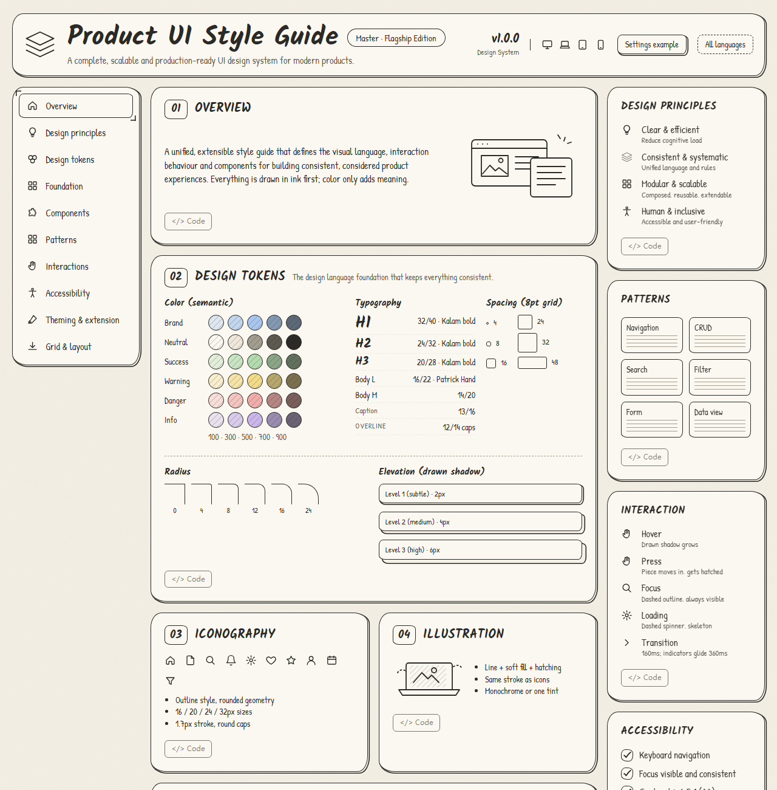
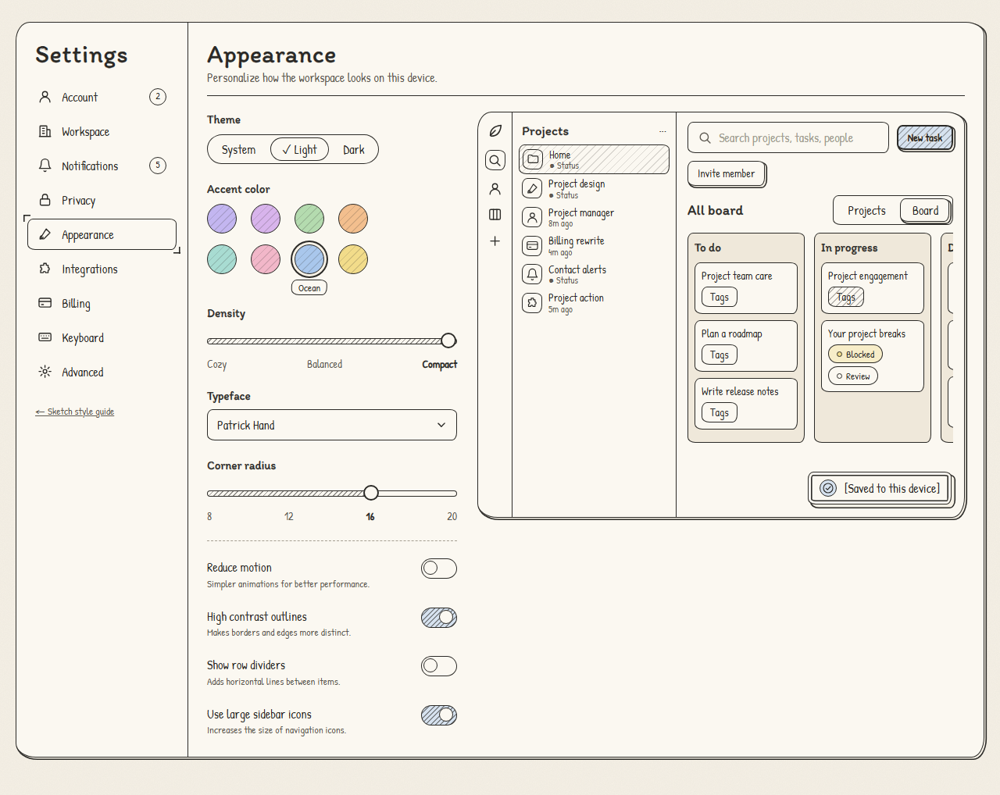

# Sketch

Hand-drawn ink on cream paper: uneven outlines, drawn offset shadows, diagonal hatching for emphasis and a few watercolor tints for meaning. A careful wireframe that works like a real UI. Plain CSS, design tokens and copy-paste HTML; no build step, no dependencies.

**Live:** [Style guide](https://seiya058904.github.io/ui-design-languages/sketch/) · [Settings example](https://seiya058904.github.io/ui-design-languages/sketch/examples/settings.html)



## Quick start

```html
<link href="https://fonts.googleapis.com/css2?family=Itim&family=Patrick+Hand&display=swap" rel="stylesheet">
<link rel="stylesheet" href="https://cdn.jsdelivr.net/gh/seiya058904/ui-design-languages@main/sketch/css/sketch.css">

<section class="sketch-box">
  <h2 class="sketch-box__title"><span>01</span>Overview</h2>
  <button class="sketch-btn sketch-btn--primary">Create new</button>
  <button class="sketch-btn sketch-btn--ghost">Cancel</button>
</section>

<script src="https://cdn.jsdelivr.net/gh/seiya058904/ui-design-languages@main/sketch/js/sketch.js"></script>
```

## Components

| Block | Classes |
| --- | --- |
| Paper & structure | `.sketch-box` (+ `__title`), `.sketch-frame`, `.sketch-dim`, `.sketch-rule`, `.sketch-hatched`, type `.sketch-display`, `-h1…h3`, `-caption`, `-overline` |
| Button | `.sketch-btn` + `--primary` `--tertiary` `--ghost` `--destructive` · `--sm` `--lg` `--icon` `--block` · `aria-busy` + `.sketch-spinner` · `.is-hover` `.is-active` `.is-focus` · `:disabled` |
| Inputs | `.sketch-input` (input / textarea / select), `.sketch-input-icon`, `.sketch-tags`, `.sketch-form-row`, `.sketch-field-label`, `.sketch-hint` |
| Selection | `.sketch-check` with `.sketch-checkbox` (incl. indeterminate), `.sketch-radio`, `.sketch-toggle`; `.sketch-stepper`; `.sketch-range` + `.sketch-slider` |
| Tags | `.sketch-tag` (`--active`), `.sketch-badge` (`--new` `--updated` `--beta` `--hot` `--info`), `.sketch-chip` (`[aria-pressed]`, `--add`), `.sketch-status`, `.sketch-count` |
| Navigation | `.sketch-tabs` (+ `--folder`), `.sketch-pills`, `.sketch-segmented`, `.sketch-breadcrumb`, `.sketch-pagination`, `.sketch-nav` (box + corner brackets) — sliding indicators |
| Feedback | `.sketch-alert` (`--success` `--warning` `--danger` `--info`), `.sketch-toast`, `.sketch-dialog`, `.sketch-tip`, `.sketch-popover`, `.sketch-tooltip[data-tip]`, `.sketch-close` |
| Data | `.sketch-card`, `.sketch-placeholder`, `.sketch-list`, `.sketch-table`, `.sketch-empty` |
| Progress | `.sketch-progress`, `.sketch-steps`, `.sketch-ring`, `.sketch-skeleton`, `.sketch-spinner` |
| Color | `.sketch-swatch` (`--pick` with `data-label`), `.sketch-ramp`, `.sketch-code` |
| Entrance | `.sketch-enter` (children enter one after another on page load) |

## Tokens

`tokens/tokens.json` → `tokens/tokens.css`. Rebuild from the repo root with `node scripts/build-tokens.mjs sketch`.

| Role | Token | Value |
| --- | --- | --- |
| Paper / panel / well | `--sketch-color-paper` / `-panel` / `-well` | `#F6F1E6` / `#FBF8F1` / `#EFE8DA` |
| Ink / soft / faint | `--sketch-color-ink` / `-ink-soft` / `-ink-faint` | `#2B2A27` / `#5E5A52` / `#A39D90` |
| Tints | `--sketch-color-brand` `-success` `-warning` `-danger` `-info` | `#A9C7EC` `#B4DBAF` `#F2DC8A` `#F0AEAB` `#CBB7EA` |
| Hatching | `--sketch-hatch-default` / `-dense` / `-light` | ink 32% / 50% / 16% at −45° |
| Lines | `--sketch-line-regular` / `-bold` / `-thick` | 1.6 / 2.2 / 3px |
| Drawn shadow | `--sketch-shadow-1/2/3` | 2 / 4 / 6px offset outline |

## Example



`examples/settings.html` — appearance settings with a theme switch, an accent picker that really re-tints the page, sliders, toggles, a board preview and a "[Saved to this device]" toast.

For AI agents: read [DESIGN.md](DESIGN.md) and [AGENTS.md](AGENTS.md) first.
