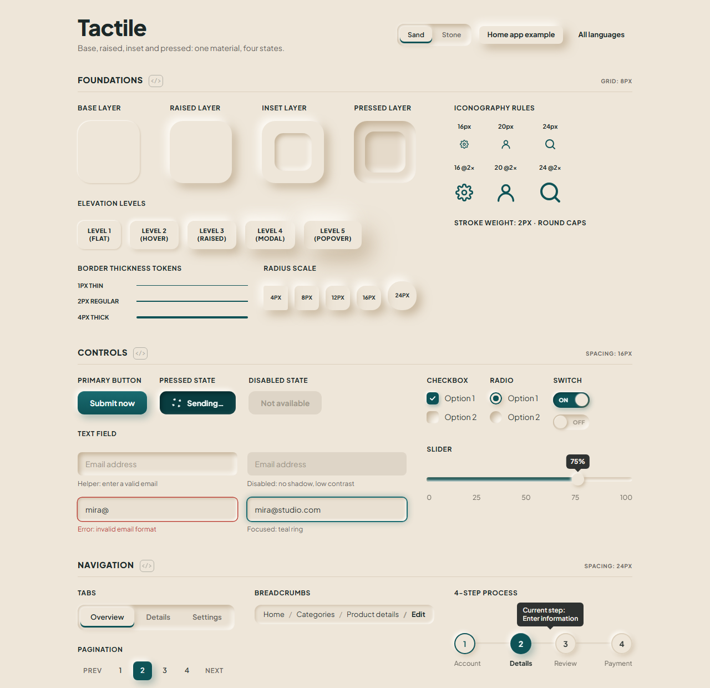
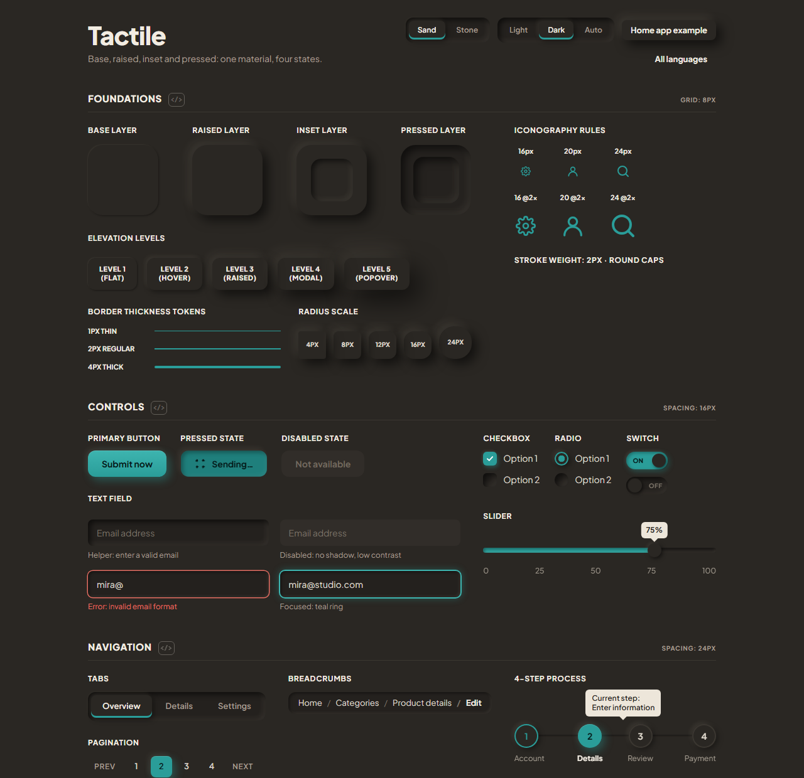
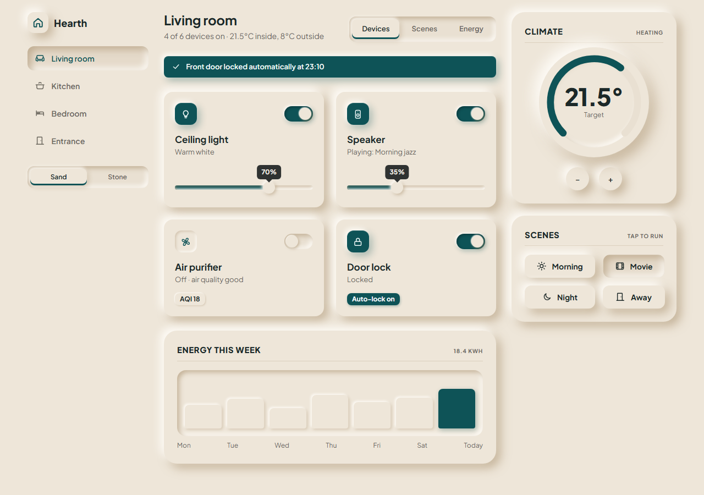

# Tactile

Warm sand neumorphism with a deep teal accent: one material, four states — base, raised, inset, pressed — and five elevation levels. A cool **stone** tone is one attribute away. Plain CSS, design tokens and copy-paste HTML; no build step, no dependencies.

**Live:** [Styleguide](https://seiya058904.github.io/ui-design-languages/tactile/) · [Home app example](https://seiya058904.github.io/ui-design-languages/tactile/examples/home.html) · [Components](https://seiya058904.github.io/ui-design-languages/tactile/components.html)

| Light | Dark |
| --- | --- |
|  |  |

## Quick start

```html
<link href="https://fonts.googleapis.com/css2?family=Plus+Jakarta+Sans:wght@400;500;600;700;800&display=swap" rel="stylesheet">
<link rel="stylesheet" href="https://cdn.jsdelivr.net/gh/seiya058904/ui-design-languages@main/tactile/css/tactile.css">

<section class="tactile-panel">
  <header class="tactile-section"><h2>Controls</h2><span>Spacing: 16px</span></header>
  <button class="tactile-btn tactile-btn--primary">Submit now</button>
  <input class="tactile-input" placeholder="Email address" aria-label="Email address">
</section>

<script src="https://cdn.jsdelivr.net/gh/seiya058904/ui-design-languages@main/tactile/js/tactile.js"></script>
```

Stone tone: `<html data-tone="stone">`, or `[data-tone-set="sand|stone"]` controls (remembered in `localStorage`).

Dark theme: `<html data-theme="dark">` (or `"auto"`), or `[data-theme-set="light|dark|auto"]` / `[data-theme-toggle]` controls with `js/tactile.js` (remembered as `tactile-theme`). Works with both tones.

## Components

| Block | Classes |
| --- | --- |
| Type & structure | `.tactile-display`, `-title`, `-heading`, `-label`, `-caption`, `.tactile-section` (title + spec note), `.tactile-panel` |
| Material | `.tactile-layer` + `--base` `--raised` `--inset` `--pressed`, `.tactile-level-1…5` |
| Button | `.tactile-btn` + `--primary` `--ghost` · `--sm` `--lg` `--icon` `--round` `--block` · `aria-busy="true"` (pressed + spinner) · `:disabled` |
| Inputs | `.tactile-input` (input / select / textarea), `.tactile-field` (grooved, front-faced), `.tactile-form-row`, `.tactile-field-label`, `.tactile-hint` (`--error`) |
| Selection | `.tactile-check` with `.tactile-checkbox`, `.tactile-radio`, `.tactile-toggle` (`--label` shows ON / OFF) |
| Slider | `.tactile-range` > `__bubble` + `input.tactile-slider` + `__ticks` |
| Dial | `.tactile-dial` (`--tactile-dial` 0–1, `--tactile-dial-size`) > `__face` (`__scale` arc SVG, `__knob[role=slider]` with `__notch`, `__readout`) + `__controls` with `[data-tactile-dial="-1|1"]` |
| Tabs, chips | `.tactile-tabs` > `__item[role=tab]` (+ `__count`), `.tactile-tabpanel` · `.tactile-chips` > `.tactile-chip[aria-pressed]`, `.tactile-chip--input` + `__remove` |
| Navigation | `.tactile-segmented` (raised tile with teal bar, gliding), `.tactile-breadcrumb`, `.tactile-pagination`, `.tactile-steps` (`li.is-done`, `li[aria-current="step"]`), `.tactile-nav` (pressed well, gliding) |
| Data | `.tactile-card` (`__icon`, `__title`, `__text`), `.tactile-list` (`__item[aria-selected]`), `.tactile-badge` (`--soft` `--danger` `--warning`), `.tactile-avatar` (`.is-active`), `.tactile-table` (raised header) |
| Feedback | `.tactile-dialog`, `.tactile-warning-mark`, `.tactile-toast(-stack)`, `.tactile-alert` (`--danger`), `.tactile-progress`, `.tactile-spinner`, `.tactile-skeleton`, `.tactile-empty` |
| Annotation | `.tactile-tip` (static bubble), `.tactile-tooltip[data-tip]`, `.tactile-note` (dot + dashed leader) |
| Entrance | `.tactile-enter` (children enter one after another on page load) |

## Tokens

`tokens/tokens.json` → `tokens/tokens.css`; tone variant `tokens/tokens.tone-stone.json`; dark theme `tokens/tokens.dark.json` and `tokens/tokens.dark.tone-stone.json`. Rebuild from the repo root with `node scripts/build-tokens.mjs tactile`.

| Role | Token | Sand | Stone |
| --- | --- | --- | --- |
| Material | `--tactile-color-surface` | `#EEE6D9` | `#E7E8EB` |
| Well / pressed | `--tactile-color-well` / `-surface-pressed` | `#E9E0D2` / `#E5DACA` | `#E1E3E6` / `#DCDEE2` |
| Light / shade | `--tactile-color-light` / `-dark` | warm white / `rgba(166,140,104,.42)` | white / `rgba(134,141,154,.45)` |
| Accent | `--tactile-color-primary` | `#0E5357` | `#2B5BD3` |
| Ink / muted | `--tactile-color-ink` / `-text-muted` | `#1C2828` / `#6A665D` | `#1C1F25` / `#626873` |
| Radius | `--tactile-radius-xs…xl` | 4 / 8 / 12 / 16 / 24 | |
| Borders | `--tactile-border-thin/regular/thick` | 1 / 2 / 4 | |

## Example



`examples/home.html` — a smart-home panel: rooms, device cards with toggles and dimmers, a thermostat dial, scenes and weekly energy.

For AI agents: read [AGENTS.md](AGENTS.md) first.
