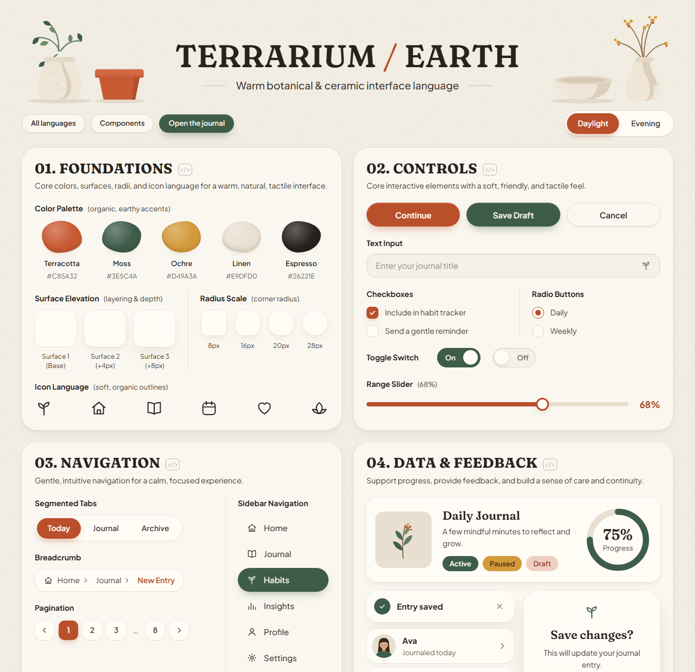
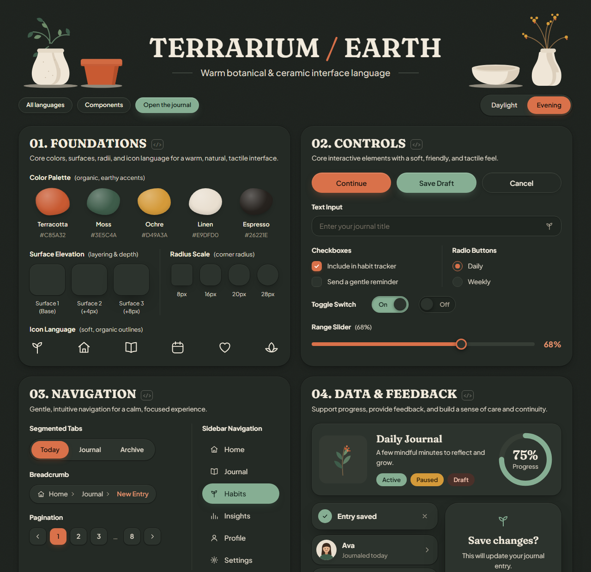
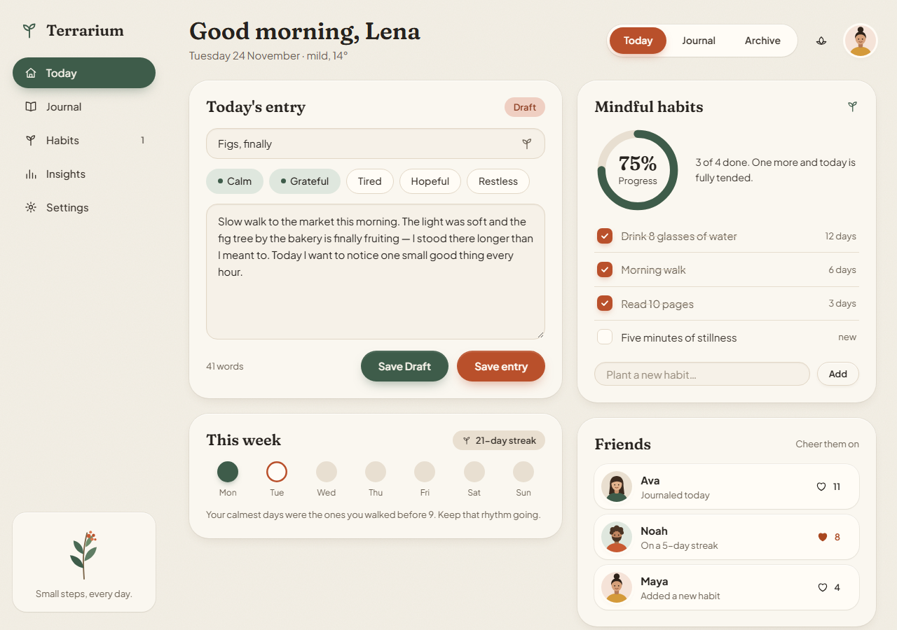

# Terrarium / Earth

A warm botanical and ceramic interface language: oat-linen paper, glazed cream cards with warm layered shadows, pebble shapes, and a windowsill palette — terracotta, moss, ochre, linen, espresso. A soft serif for headings and organic motion that settles like a leaf. Plain CSS, design tokens and copy-paste HTML; no build step, no dependencies.

**Live:** [Styleguide](https://seiya058904.github.io/ui-design-languages/terrarium/) · [Journal example](https://seiya058904.github.io/ui-design-languages/terrarium/examples/journal.html) · [Components](https://seiya058904.github.io/ui-design-languages/terrarium/components.html)

| Daylight | Evening |
| --- | --- |
|  |  |

## Quick start

```html
<link href="https://fonts.googleapis.com/css2?family=Fraunces:opsz,wght,SOFT,WONK@9..144,400..700,0..100,0..1&family=Plus+Jakarta+Sans:wght@400;500;600;700&display=swap" rel="stylesheet">
<link rel="stylesheet" href="https://cdn.jsdelivr.net/gh/seiya058904/ui-design-languages@main/terrarium/css/terrarium.css">

<section class="terrarium-card">
  <h2 class="terrarium-section-title">02. Controls</h2>
  <button class="terrarium-btn terrarium-btn--primary">Continue</button>
  <button class="terrarium-btn terrarium-btn--secondary">Save Draft</button>
</section>

<script src="https://cdn.jsdelivr.net/gh/seiya058904/ui-design-languages@main/terrarium/js/terrarium.js"></script>
```

Evening theme: `<html data-theme="dark">` (or `"auto"`), or `[data-theme-set="light|dark|auto"]` / `[data-theme-toggle]` controls with `js/terrarium.js` (remembered as `terrarium-theme`).

## Components

| Block | Classes |
| --- | --- |
| Structure | `.terrarium-display`, `.terrarium-tagline`, `.terrarium-section-title`, `.terrarium-lede`, `.terrarium-title`, `.terrarium-label`, `.terrarium-card` (`--flat` `--raised`), `.terrarium-grow` (entrance) |
| Actions | `.terrarium-btn` + `--primary` `--secondary` `--ghost` · `--sm` `--lg` `--icon` `--block` |
| Inputs | `.terrarium-field` (`__label`), `.terrarium-input` (`aria-invalid`), `.terrarium-affix` (`--start`), `.terrarium-hint` (`--error`) |
| Choices | `.terrarium-check`, `.terrarium-checkbox`, `.terrarium-radio`, `.terrarium-switch` (`data-on` / `data-off`, `--sm`), `.terrarium-range` + `.terrarium-slider`, `.terrarium-chip[aria-pressed]` (`[data-terrarium-single]`) |
| Navigation | `.terrarium-segmented` (`--block`), `.terrarium-tabs`, `.terrarium-nav` (`__item[aria-current]`, `__count`), `.terrarium-breadcrumb`, `.terrarium-pagination` |
| Data | `.terrarium-feature` (`__art` `__text` `__badges`), `.terrarium-badge` (`--active` `--paused` `--draft`), `.terrarium-ring` (`--sm`), `.terrarium-progress` (`--terracotta`), `.terrarium-table`, `.terrarium-avatar` (`--sm` `--lg`, `.terrarium-avatar-stack`), `.terrarium-list` |
| Feedback | `.terrarium-toast`, `.terrarium-alert` (`--ochre` `--terracotta`), `.terrarium-dialog` (`__icon` `__title` `__text` `__actions`), `.terrarium-tooltip[data-tip]`, `.terrarium-tip` |
| Garden | `.terrarium-garden` (`__plant` with `__stem` / `__leaf--1…3` / `__bloom` / `__pot` / `__soil`, `__body`, `__list`, `__note`) + a `.terrarium-ring` — habits, sprout and ring grow together |
| Calendar | `.terrarium-calendar` (`__head`, `__streak`, `__grid`, `__dow`, `__pad`, `__day[aria-pressed]`, `[aria-current="date"]`) |
| Mood | `.terrarium-mood` (`--terrarium-mood` 0–4, `data-mood`) > `__fan[role=radiogroup]` > `__option[role=radio]` (`--a` angle), `__knob`, `__label` |
| Material | `.terrarium-pebble` (`--2…--5`, `--breathe`), `.terrarium-surface` (`--1…--3`) |

## Tokens

`tokens/tokens.json` → `tokens/tokens.css`; evening `tokens/tokens.dark.json`. Rebuild from the repo root with `node scripts/build-tokens.mjs terrarium`.

| Role | Token | Daylight | Evening |
| --- | --- | --- | --- |
| Canvas / card | `--terrarium-color-canvas` / `-surface` | `#F3EFE6` / `#FAF7F0` | `#1B201C` / `#242A25` |
| Terracotta | `--terrarium-color-primary` | `#B9502B` (palette `#C85A32`) | `#D9714A` |
| Moss | `--terrarium-color-secondary` | `#3E5C4A` | `#86AE93` |
| Radius | `--terrarium-radius-sm…xl` | 8 / 16 / 20 / 28 | |
| Motion | `--terrarium-motion-duration` · `-easing` | 300ms · `cubic-bezier(.34,1.35,.64,1)` | |

## Example



`examples/journal.html` — a daily journal and habit tracker: write today's entry (word count, moods, drafts), tick off habits and watch the moss ring grow — finish them all and a sprout grows; plant new habits, cheer on friends, and if you leave with unsaved words it gently asks "Save changes?".

For AI agents: read [AGENTS.md](AGENTS.md) first.
