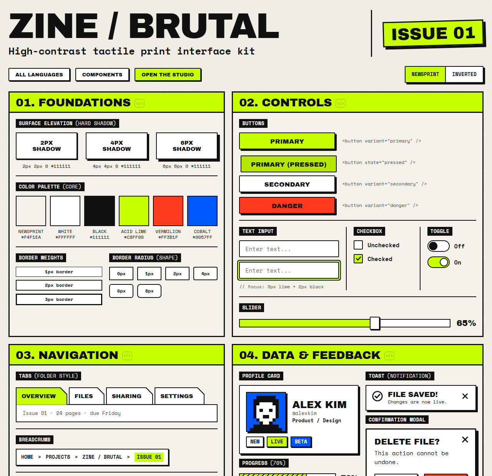
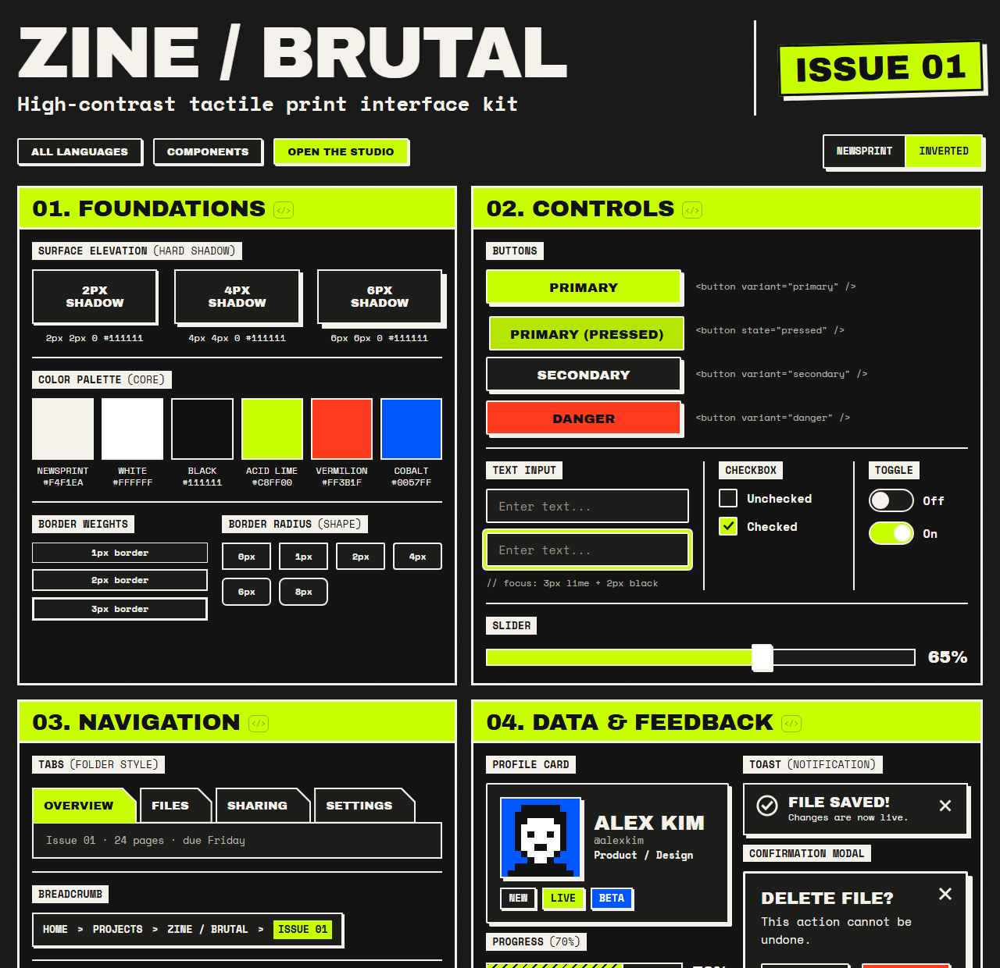
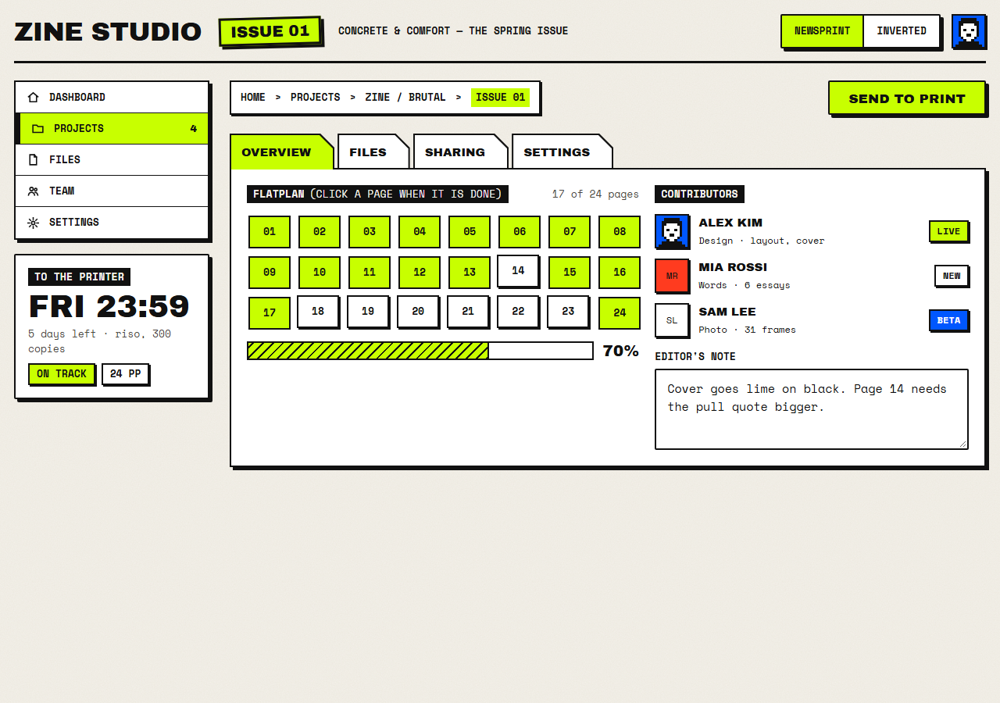

# Zine / Brutal

A high-contrast tactile print interface kit: newsprint paper, 2px black rules, zero-blur hard shadows and three loud inks — acid lime, vermilion and cobalt. Buttons lift off the page and slam flat, checks are stamped on, folder tabs run into their sheets. Plain CSS, design tokens and copy-paste HTML; no build step, no dependencies.

**Live:** [Styleguide](https://seiya058904.github.io/ui-design-languages/zine/) · [Studio example](https://seiya058904.github.io/ui-design-languages/zine/examples/studio.html) · [Components](https://seiya058904.github.io/ui-design-languages/zine/components.html)

| Newsprint | Inverted print |
| --- | --- |
|  |  |

## Quick start

```html
<link href="https://fonts.googleapis.com/css2?family=Archivo+Black&family=Space+Grotesk:wght@400;500;700&family=Space+Mono:wght@400;700&display=swap" rel="stylesheet">
<link rel="stylesheet" href="https://cdn.jsdelivr.net/gh/seiya058904/ui-design-languages@main/zine/css/zine.css">

<section class="zine-panel">
  <header class="zine-panel__head"><h2 class="zine-title">02. Controls</h2></header>
  <div class="zine-panel__body">
    <span class="zine-label">Buttons</span>
    <button class="zine-btn zine-btn--primary">Primary</button>
  </div>
</section>

<script src="https://cdn.jsdelivr.net/gh/seiya058904/ui-design-languages@main/zine/js/zine.js"></script>
```

Inverted print: `<html data-theme="dark">` (or `"auto"`), or `[data-theme-set="light|dark|auto"]` / `[data-theme-toggle]` controls with `js/zine.js` (remembered as `zine-theme`).

## Components

| Block | Classes |
| --- | --- |
| Structure | `.zine-display`, `.zine-deck`, `.zine-title`, `.zine-heading`, `.zine-panel` (`__head` `__body`), `.zine-label` (+ `<small>`), `.zine-code`, `.zine-mark`, `.zine-meta`, `.zine-rule`, `.zine-press` (entrance) |
| Actions | `.zine-btn` + `--primary` `--danger` `--info` `--ghost` · `--sm` `--lg` `--icon` `--block` · `.is-hover` `.is-pressed` |
| Inputs | `.zine-field` (`__label`), `.zine-input` (`aria-invalid`), `.zine-hint` (`--error`), `.zine-search` |
| Choices | `.zine-check`, `.zine-checkbox`, `.zine-radio`, `.zine-switch`, `.zine-range` + `.zine-slider`, `.zine-segmented`, `.zine-chip[aria-pressed]` (`[data-zine-single]`) |
| Navigation | `.zine-tabs` + `.zine-sheet`, `.zine-breadcrumb`, `.zine-pagination`, `.zine-menu` (`__item[aria-current]`, `__count`) |
| Data | `.zine-card` (`--hover`, `__head` `__text` `__actions`), `.zine-profile`, `.zine-avatar` (`--sm` `--lg`, pixel SVG with `.zine-pixel-ink` / `-face`), `.zine-sticker` (`--live` `--beta` `--hot` `--tilt`), `.zine-table` (+ `.zine-sort`), `.zine-progress` (`--live`), `.zine-meter` |
| Feedback | `.zine-toast` (`--lime`), `.zine-alert` (`--danger` `--info` `--lime`), `.zine-dialog` (`__title` `__text` `__actions` `__close`), `.zine-tooltip[data-tip]`, `.zine-tip` |
| Print | `.zine-swatch`, `.zine-block`, `.zine-issue` |
| Ticket | `.zine-ticket` (`__main`, `__kicker`, `__title`, `__meta`, `__stub` with `__code`, `__stamp`; `.is-torn`), `[data-zine-reprint]` |
| Board | `.zine-board` > `.zine-slap` (`--burst` `--circle` `--tape` `--arrow`, inks `--lime` `--vermilion` `--cobalt`; `--x` / `--y` / `--r`) — drag, nudge with arrows, slap |
| Accordion | `.zine-accordion` > `details.zine-accordion__item` (`__head`, `__body`) |

## Tokens

`tokens/tokens.json` → `tokens/tokens.css`; inverted print `tokens/tokens.dark.json`. Rebuild from the repo root with `node scripts/build-tokens.mjs zine`.

| Role | Token | Newsprint | Inverted |
| --- | --- | --- | --- |
| Paper / surface | `--zine-color-paper` / `-surface` | `#F4F1EA` / `#FFFFFF` | `#141414` / `#1D1D1C` |
| Ink | `--zine-color-ink` | `#111111` | `#F4F1EA` |
| Inks | `--zine-color-lime` / `-vermilion` / `-cobalt` | `#C8FF00` / `#FF3B1F` / `#0057FF` | same |
| Hard shadows | `--zine-shadow-sm/md/lg` | 2 / 4 / 6px, zero blur | |
| Motion | `--zine-motion-duration-press` / `-release` | 60 / 160ms | |

## Example



`examples/studio.html` — an independent publishing studio: a flatplan of 24 pages you sign off one by one (it drives the issue's progress), a hatched-header file table you can sort, filter, search, upload to and delete from, sharing with invites, and print settings that save with a toast.

For AI agents: read [AGENTS.md](AGENTS.md) first.
